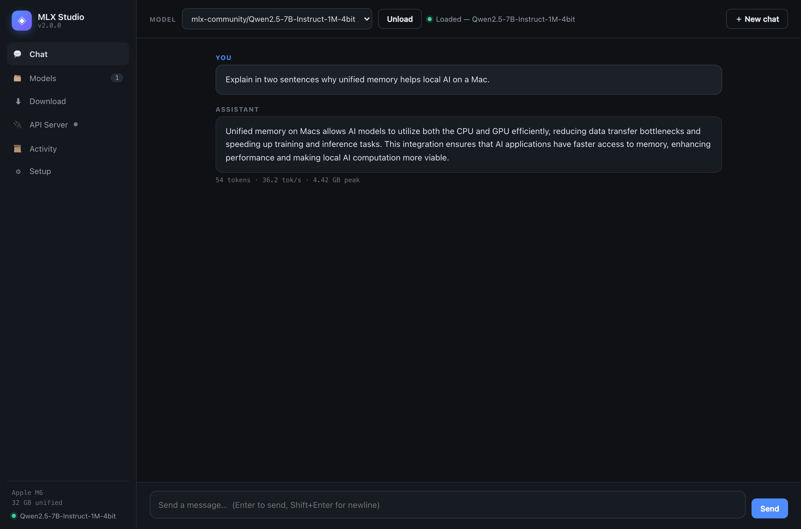

# MLX Studio — a modern local-AI desktop app for Apple Silicon

MLX Studio is an LM Studio / Ollama–style app for running MLX models on a Mac.
It has a real chat window with streaming replies, a model manager, a download
browser, an OpenAI-compatible API server, a day-to-day activity log, and a
Setup screen that reports installed versions and update availability.



## Files

| File | Purpose |
|------|---------|
| `app.py` | Backend: stdlib HTTP server + JSON/SSE API + native window host |
| `ui/index.html` | Single-page interface |
| `ui/style.css` | Dark LM Studio–style theme |
| `ui/app.js` | Front-end controller (routing, streaming, polling) |
| `Run_MLX_Manager.command` | Double-click launcher (Finder) |
| `run.sh` | Terminal launcher |
| `screenshots/` | Captured views of every screen |

## Requirements

- macOS on Apple Silicon
- Python 3.10+
- `mlx`, `mlx-lm`, `huggingface_hub` — installed by the Setup tab if missing
- `pywebview` for the native window (optional; falls back to the browser)

```bash
python3 -m pip install pywebview
```

## Run

Double-click **`Run_MLX_Manager.command`**, or:

```bash
cd "/Users/dipesh/Desktop/Dipesh/Project Idea/MLX_Model_App"
./run.sh
```

The app opens a native 1360×900 window. The local server listens on
`http://127.0.0.1:8765` and is reachable from a browser too.

## Screens

### Chat
- Model dropdown, **Load** / **Unload**, and a live state indicator:
  grey `Not loaded`, pulsing `Loading …`, green `Loaded — <model>`.
- The sidebar pill mirrors the same state, so it is visible from every screen.
- Replies stream token by token; each turn ends with
  `N tokens · X tok/s · Y GB peak`.
- **Stop** cancels generation, **New chat** clears history.
- `Enter` sends, `Shift+Enter` adds a newline; the composer grows as you type.

### Models
- Card per cached model with size and repo id, plus a `loaded` tag.
- **Load** / **Unload**, **Reveal**, **Delete** (blocked while loaded).

### Download
- Search the `mlx-community` organisation, or **Show all**.
- Download cards show live status (`running` / `success` / `failed`).

### API Server
- Start `mlx_lm server` on `http://127.0.0.1:8080/v1` for a chosen model.
- Live server output, copyable endpoint, ready-to-run `curl` example.
- State pill turns green while running; stopping is logged.

### Activity
- Filterable table: time, action, model, status, detail.
- Backed by `~/.mlx_studio/activity.log` (one JSON object per line).
- Green = success, red = failed, blue = running. **Clear** truncates the log.

### Setup
- **Application** panel: MLX Studio version, latest release, update channel,
  Python, hardware, and the timestamp of the last update check.
- **Runtime packages** panel: MLX, MLX-LM and huggingface-hub with a pill per
  row — `up to date`, `update → <version>`, or `missing`.
- **Install / Update** runs pip and streams the output into the panel.
- **Check for updates** re-queries PyPI; a `!` badge appears on the nav item
  whenever any component (app or package) has an update.

## Version and update behaviour

| Component | Source of truth |
|-----------|-----------------|
| MLX Studio | `APP_VERSION` in `app.py` |
| MLX / MLX-LM | `importlib.metadata` vs. PyPI JSON API |
| App updates | `MLX_STUDIO_UPDATE_URL` manifest (optional) |

Without a manifest the app reports itself as a `local build`. To enable app
update checks, point the variable at a JSON file:

```bash
export MLX_STUDIO_UPDATE_URL="https://example.com/mlx-studio.json"
# {"version": "2.1.0", "url": "https://example.com/MLXStudio-2.1.0.zip"}
```

## Connect Claude Code / DeepSeek

1. Start a model in **API Server**.
2. Point any OpenAI-compatible client at it:

```
Base URL: http://127.0.0.1:8080/v1
API Key:  local
Model:    <the model you started>
```

```bash
export OPENAI_BASE_URL="http://127.0.0.1:8080/v1"
export OPENAI_API_KEY="local"
export OPENAI_MODEL_NAME="mlx-community/Qwen2.5-7B-Instruct-1M-4bit"
```

```bash
curl http://127.0.0.1:8080/v1/chat/completions \
  -H "Content-Type: application/json" \
  -d '{"model":"mlx-community/Qwen2.5-7B-Instruct-1M-4bit",
       "messages":[{"role":"user","content":"Hello!"}]}'
```

## Model sizing for 32 GB unified memory

| Model | Download | Peak RAM | Use |
|-------|----------|----------|-----|
| `mlx-community/Llama-3.2-3B-Instruct-4bit` | ~2 GB | ~2 GB | fastest replies |
| `mlx-community/Qwen2.5-7B-Instruct-1M-4bit` | ~4 GB | ~4.4 GB | **recommended default** |
| `mlx-community/Qwen3.5-9B-4bit` | ~5–6 GB | ~6 GB | step up in quality |
| `mlx-community/Qwen3.8-27B-4bit` | ~16 GB | ~17 GB | strongest that still fits |

## Storage

- Models: `~/.cache/huggingface/hub/models--<org>--<name>/`
- Activity log: `~/.mlx_studio/activity.log`

## API surface

| Method | Path | Purpose |
|--------|------|---------|
| GET | `/api/state` | Full snapshot (app, versions, models, loaded, server, downloads, install) |
| GET | `/api/models` | Installed models |
| GET | `/api/search?q=` | Search mlx-community |
| GET | `/api/logs` | Activity entries |
| GET | `/api/versions` | Re-check PyPI, then return versions |
| POST | `/api/load` `{repo}` | Load a model |
| POST | `/api/unload` | Unload and clear the MLX cache |
| POST | `/api/chat` `{messages}` | SSE stream: `token`, `done`, `error` |
| POST | `/api/chat/stop` | Cancel generation |
| POST | `/api/download` `{repo}` | Start a download |
| POST | `/api/delete` `{repo}` | Delete a cached model |
| POST | `/api/server/start` `{repo}` | Start the OpenAI-compatible server |
| POST | `/api/server/stop` | Stop it |
| POST | `/api/install` `{kind}` | `install` \| `update` \| `reinstall` |
| POST | `/api/logs/clear` | Truncate the activity log |

## Troubleshooting

**No native window** — `python3 -m pip install pywebview`; otherwise the app
opens in your default browser.

**Port 8765 busy** — another MLX Studio instance is running; quit it first.

**Port 8080 busy** — stop the other server before starting the API server.

**Update check says "unknown"** — the PyPI request failed; check network/proxy.
The app injects `truststore` to fix macOS certificate chains.

**Delete refused** — unload the model in Chat first.
