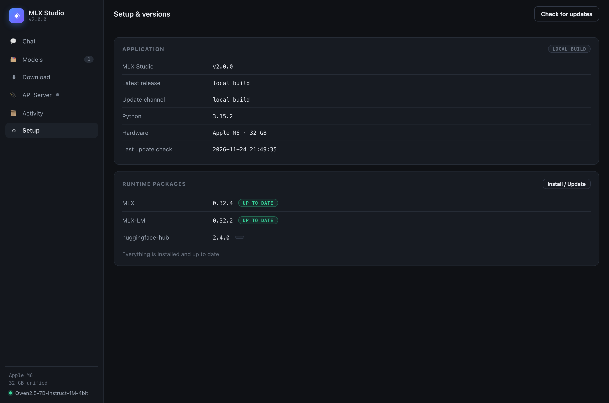

# MLX Studio

**A native macOS app for running local AI models on Apple Silicon — LM Studio / Ollama style, built on Apple's MLX.**

[](https://github.com/DipeshPansuriya/MLX_Model_App/releases/latest)
[](#requirements)
[](#requirements)
[](#license)
[](https://github.com/DipeshPansuriya/MLX_Model_App/stargazers)

MLX Studio wraps Apple's MLX runtime in a desktop UI: load a model, chat with
streaming replies, download and delete weights, serve an OpenAI-compatible API
for DeepSeek Harness or any OpenAI-compatible client, and review a day-to-day
activity log. It also reports installed versions and tells you when updates are
available.

> This page describes **2.0.9**, released on 2026-11-26 as the
> [latest release](https://github.com/DipeshPansuriya/MLX_Model_App/releases/latest).
> Text marked **unreleased** came with the 2.0.10 source or later, is in the
> 2.0.12 source, and is not in the released app ([CHANGELOG](CHANGELOG.md)). The
> screenshots show an earlier version.


---

## Install

Three routes. All end with the same app in `/Applications`.

### Option A: one-line installer

```bash
curl -fsSL https://raw.githubusercontent.com/DipeshPansuriya/MLX_Model_App/main/scripts/install.sh | bash
```

It downloads the DMG of the latest release, checks its SHA-256 against the line
for that exact file in `release/SHA256SUMS` on `main`, copies the new app next to
the old one, checks the signature, then swaps them and opens the app.

| Note | Detail |
|---|---|
| Fails closed | No checksum line for the file, or a mismatch, means nothing is installed |
| Availability | Needs a line for the version in `release/SHA256SUMS` on `main`. The file lists the 2.0.9 dmg and pkg. 2.0.8 and older are not backfilled ([release steps](docs/DEPLOYMENT.md)). Versions with no line are refused |
| Signature | Ad-hoc: it detects a damaged bundle, not who published it |
| Options | `--version <x.y.z>`, `--dir ~/Applications`, `--no-launch` |

Pass options after `bash -s --`:

```bash
curl -fsSL https://raw.githubusercontent.com/DipeshPansuriya/MLX_Model_App/main/scripts/install.sh \
  | bash -s -- --dir ~/Applications --no-launch
```

`curl` sets no quarantine flag, so macOS does not show the "Not Opened" dialog.
See [ADR-007](docs/adr/ADR-007-adhoc-signing.md).

### Option B: pkg

Download `MLX.Studio-<version>.pkg` from
[**Releases**](https://github.com/DipeshPansuriya/MLX_Model_App/releases/latest)
and double-click it. It installs to `/Applications`, and the installed app carries
no quarantine flag. The package itself is not signed: how current macOS treats a
browser-downloaded copy of it is not verified. If macOS blocks it, use
**System Settings → Privacy & Security → Open Anyway**.

### Option C: DMG

A browser download carries `com.apple.quarantine`. Clear it on the DMG before you
open it. Replace `<version>` with the downloaded version.

```bash
xattr -dr com.apple.quarantine ~/Downloads/MLX.Studio-<version>.dmg
```

Then double-click the DMG, drag **MLX Studio** onto the **Applications** shortcut,
eject the DMG and open the app from Applications.

### Check that it is running

```bash
curl -s http://127.0.0.1:8765/api/ping
# {"ok": true, "app": "<version>"}
```

#### If macOS says "Not Opened"

The quarantine flag is still attached. Clear it on the installed copy:

```bash
xattr -dr com.apple.quarantine "/Applications/MLX Studio.app"
open "/Applications/MLX Studio.app"
```

The GUI equivalent:

| macOS | Route |
|---|---|
| **15 Sequoia or newer** | **System Settings → Privacy & Security → Security → Open Anyway**, authenticate, confirm **Open** |
| **14 Sonoma or older** | Right-click the app → **Open** → **Open** |

See [RUNBOOK §4.7](docs/RUNBOOK.md) for the full diagnosis.

#### Uninstall

```bash
rm -rf "/Applications/MLX Studio.app"
```

Model weights stay in the Hugging Face cache and logs in `~/.mlx_studio/`.
Remove those too if you want a clean slate.

### Run from source

```bash
git clone https://github.com/DipeshPansuriya/MLX_Model_App.git
cd MLX_Model_App
./run.sh
```

`Run_MLX_Manager.command` is the double-clickable Finder launcher.

---

## Requirements

| | |
|---|---|
| OS | macOS 12+ on Apple Silicon. The launcher is built for 12.0; macOS 12 was not tested, and the MLX packages may need a newer macOS (not verified) |
| Python | 3.10+ from [python.org](https://www.python.org/downloads/macos/) or `brew install python` |
| Packages | `mlx`, `mlx-lm`, installed from the in-app **Setup** tab at the pinned versions |
| Optional | `pywebview` for the native window (falls back to the browser) |

```bash
python3 -m pip install pywebview
```

A system-managed Python (for example Homebrew) may refuse `pip`. Create a virtual
environment (`python3 -m venv ~/mlx-venv`) and run the app from source with it.
The double-clicked app does not look in that folder.

---

## Screens

| Chat | Models |
|---|---|
|  |  |

| Download — best for your Mac | API Server — background mode |
|---|---|
|  |  |

| Activity — log folder and export | Setup |
|---|---|
|  |  |

---

## Features

### Chat
2.0.13 source (unreleased). Chat asks the running API server; the app loads no
model of its own. Released builds load a second copy for Chat.

- Start the API server first. While it is stopped, Chat says so and offers
  **Go to API Server**; while it starts or restarts, typing is off.
- The **Model** list holds only the served models. One model is selected already;
  with two, your choice is kept while it is served.
- Streaming replies. A reply's reasoning sits in a collapsed **Thinking** block
  above the answer.
- Under each reply, a small line: reply size, time to the first answer, writing
  speed, prompt size and the performance mode. The counts come from the API
  server, the times from this app. A figure that is not known is left out.
- The top of the page names the mode in force, with a link to **Configuration**.
- A server busy with another client shows a waiting line.
- **Stop** cancels the request on the server, **New chat** resets history.
- `Enter` sends, `Shift+Enter` inserts a newline.
- One reply at a time. A failed turn, or a reply that is only thinking, is removed
  from the history.

### Models
- Card per cached model with its size on disk, repo id and folder path.
- **Reveal** (opens the folder in Finder), **Copy model
  name** (full repo id) and **Delete**.
- Delete is refused while the model is served, starting or
  downloading.
- A partial download shows **incomplete** with **Resume download**.

### Download
- **Best for your Mac**: 25 `mlx-community` models, each rated against this
  machine's unified memory (`great fit`, `good fit`, `tight fit`, `too large`)
  from the 4-bit weight size. The rating does not include context memory.
- Filter by fit band or category, or search the
  [`mlx-community`](https://huggingface.co/mlx-community) organisation.
- Search results use the same cards, with fit and size. Sizes marked (estimate)
  come from the parameter count; missing details show as unknown.
- Progress counted in bytes, current file name, **Cancel**, and an Active
  Downloads section that starts collapsed and shows count and progress. Cancelling inside a Xet-backed file was not tested.

### API Server
- Starts `mlx_lm server` through MLX Studio's request guard on
  `http://127.0.0.1:8080/v1`, with 8192 reply tokens by default.
- Live server output, copyable endpoint and `curl` example.
- Unreleased (2.0.12 source): one card, **Models (max 2)**. **+ Add model** opens
  the searchable list; **×** removes a model. See
  [the API Server card](#the-api-server-card).
- Context, reply limits, cache and memory settings are on the
  [Configuration page](#configuration) (2.0.13, unreleased).
- Warns when the chosen model is marked as unable to call tools.
- **Background**: the server keeps running after the window closes. Its process
  id is saved in `~/.mlx_studio/server.pid` and adopted on the next launch only if
  the command line and start time still match.
- If the server dies, the view shows a banner with **Restart** and records the
  event.
- Since 2.0.10: can keep [two models loaded](#one-or-two-models) at once.

### Configuration
2.0.13 source (unreleased). Replaces the Settings box on the API Server card.

- Pick **All models (defaults)** or an installed model. Fields: max context,
  server reply cap, Chat reply cap, temperature, top-p, prompt cache size and
  bytes, two-model context cap, and the memory limit (All models only).
- Each field shows the value that applies; empty means automatic, or under a model
  the All models value. **Save** stores only what you changed; **Reset this
  entry** clears one entry.
- A max context lowered to fit memory is said on the page. Server limits apply at
  the next start or **Apply changes**; Chat values apply to the next message.
- [Keys and ranges](docs/API.md#6b-user-settings).

#### Performance mode (no commands needed)

| Choice | What it does |
|---|---|
| **Standard (recommended)** | Nothing changes |
| **Save memory** | Uses less memory but reads new prompts about half as fast (measured on one model and one Mac). Compression starts after 5,000 tokens; requests are answered one at a time |
| **Advanced** | Three raw settings. 4-bit produced broken answers in testing |

To try a mode:

1. Open **Configuration**. Keep **All models (defaults)**, or pick one model.
2. Choose a **Performance mode**, then press **Save**.
3. Open **API Server** and press **Stop**, then **Start Server** (or **Apply changes**).
4. Open **Chat**, check the mode named at the top, and ask a question. The line
   under the reply shows the speed.
5. To compare memory too, stop the API server, run **Load Test** once in each
   mode, and read the results: each one lists the settings it ran with.

A model that cannot use compressed memory has the choice switched off, with the
reason, and runs in Standard. The automatic prompt limit is the same in every mode.

### Load Test
2.0.13 source (unreleased). Measures one model on this Mac. **Not yet run with a
real model.** [How to run it safely](docs/RUNBOOK.md#37a-run-a-load-test-safely).

- Tick context sizes or type your own (up to 8 in one test). The API server must
  be stopped; the page says so and offers **Stop API server**.
- Shows live progress and memory, and **Cancel test**. A size is not sent when
  memory is projected over the gate (75%), and the test server is ended at 77%.
  Memory is sampled, so staying under 80% cannot be guaranteed.
- Results: size, read speed, first-token time, write speed, peak memory and the
  settings used, with earlier runs. **Apply this size to config** saves a passed
  size as that model's max context. Old results are tagged **stale**.

### Activity
- Filterable log of chats, loads, downloads, deletes, installs and server events.
- **Export diagnostics** downloads a zip of the log folder plus an environment
  report.

### Setup
- Installed versions of MLX, MLX-LM and huggingface-hub.
- **Check for updates** queries PyPI for the latest MLX releases and, if
  configured, the app manifest.
- **Install / Update** runs pip with the pinned `mlx`, `mlx-lm` and
  `huggingface-hub` 2.4.0 versions; a newer installed version is kept.

---

## Version and update checks

| Component | Source of truth |
|---|---|
| MLX Studio | `APP_VERSION` in [`app.py`](app.py) |
| MLX / MLX-LM | `importlib.metadata` vs. the PyPI JSON API |
| App updates | `MLX_STUDIO_UPDATE_URL` release manifest |

Installed copies check for a newer release by fetching a small JSON manifest:

```json
{
  "version": "2.1.0",
  "url": "https://github.com/DipeshPansuriya/MLX_Model_App/releases/download/v2.1.0/MLX.Studio-2.1.0.pkg",
  "notes": "Example release notes",
  "published": "2026-11-24T22:00:00Z",
  "sha256": "<64 hex characters>",
  "size": 1000000
}
```

Point the app at it:

```bash
export MLX_STUDIO_UPDATE_URL="https://raw.githubusercontent.com/DipeshPansuriya/MLX_Model_App/main/release/latest.json"
```

When the manifest version is newer, Setup shows an **App update available** panel
with the release notes, the published SHA-256 and a **Download installer** button
(the published link is the `.pkg`). Only `https` links are opened. The app does not check the downloaded file for you.

---

## Build and release

Needs the Xcode command line tools (`clang`).

```bash
./packaging/build_app.sh              # app, dmg, pkg and dist/SHA256SUMS
./packaging/build_app.sh --app-only   # app bundle only
./packaging/build_app.sh --no-sign    # skip ad-hoc codesigning
```

The script compiles `packaging/launcher.c` for macOS 12.0 and stops if the binary
reports a different minimum. Unreleased: it also stops if `codesign` fails or
`app.py` lacks exactly one `APP_VERSION = "X.Y.Z"` line. Release files are generated from that exact build
(Python 3.11+), never edited by hand:

```bash
python3 packaging/release_manifest.py --dist dist --notes "<release notes>"
python3 packaging/release_manifest.py --verify --release --dist dist
```

---

## Connect DeepSeek Harness or any OpenAI-compatible client

The server offers the OpenAI-style API only. It has no `/v1/messages` route, so a
client that speaks only the Anthropic API (such as Claude Code) cannot connect to
it directly.

1. Download the model in MLX Studio, then start it in the **API Server** tab.
2. Point the client at it:

```
Base URL: http://127.0.0.1:8080/v1
API Key:  local            (any value; the server does not check it)
Model:    mlx-community/Qwen2.5-7B-Instruct-1M-4bit
```

```bash
curl http://127.0.0.1:8080/v1/chat/completions \
  -H "Content-Type: application/json" \
  -d '{"model":"mlx-community/Qwen2.5-7B-Instruct-1M-4bit",
       "messages":[{"role":"user","content":"Hello!"}]}'
```

### Rules the server enforces

| Rule | Otherwise |
|---|---|
| Use `127.0.0.1`, `localhost` or `[::1]` as the host name (any port) | `403` |
| Send POSTs as `Content-Type: application/json` | `415` |
| Name `default_model`, the started model, or a complete downloaded model | `400`; nothing is downloaded |
| No `draft_model` or `adapters` | `400` |
| Images must be `data:` URLs; `http(s)` and other URLs are refused | `400` |
| Web pages on other origins | `403` |

After updating, if the app shows **server unprotected**, open API Server and press
**Restart now**.

### Tool calling

| Model | Tool calls | Basis (2026-11-25, mlx_lm 0.32.2) |
|---|---|---|
| `mlx-community/Qwen2.5-7B-Instruct-1M-4bit` | **Yes (verified)** | 60 of 60 tool probes returned `tool_calls` |
| `mlx-community/Qwen2.5-Coder-7B-Instruct-4bit` | **No** | Writes the call as plain text; the client gets no tool call |
| `mlx-community/DeepSeek-R1-Distill-Qwen-7B-4bit` | No | Its cached chat template has no tools; not run |
| Others | Unknown | Not checked |

These are measurements on one Mac, not repeated for every release. With a large
tool list (35 tools) the verified model answered a bare greeting with a tool call
in 8 of 8 tries. Adding this instruction to the client gave plain text in 24 of 24:
`For greetings or chat, answer in plain text without calling any tool.`

### Context window

Set this in the client. The server has no context-size setting and does not
reject long input; too much context fails through memory or quality.

| Model | Recommended | In tokens |
|---|---|---|
| `Qwen2.5-7B-Instruct-1M-4bit` | **96K** | 98304 |
| `Qwen2.5-Coder-7B-Instruct-4bit` | **32K** (model limit) | 32768 |

The figures are for a 32 GB Mac and are **calculated from measured bytes per
token, not load-tested**. They include the reply. 500K or 1M context is not
proven and is not recommended here. They are for one model; with two models
loaded, use the safe context the API Server view shows.

In the unreleased 2.0.13 source the one-model limit also follows the memory other
apps hold, and can be much lower than these figures:
[prompt limit](docs/ARCHITECTURE.md#62-prompt-limit).

### The API Server card

**Unreleased (2.0.12 source).**

| Part | Behaviour |
|---|---|
| **Models (max 2)** | The chosen models, each with its context figure when known and a remove button. The same model cannot be added twice. At two, **+ Add model** is off and says why |
| When the app opens | With the server stopped, the models of the last start that reported ready are already chosen, so **Start Server** is one click. Models no longer installed completely are left out; with nothing remembered the list is empty. Nothing starts by itself |
| While a server runs | The list shows what it was started with. Your edits stay until you apply them or a new server starts; edits made while a start is under way stay after it |
| **Restart** | After the server stops unexpectedly or cannot start: starts the models and mode that last ran, not an unapplied choice, leaving out models no longer installed completely. If a new set and the previous one both failed, it may retry the failed new set. **Background** mode is not remembered after the app is closed |
| Memory | **Memory: X / Y GB**: what the choice needs (or, for the unchanged running server, uses) out of what the API server may use. Hidden while two models are refused. **Details** holds the longer explanations |
| Warnings | A refusal or a shorter context is shown on the card without opening Details. One model is never refused; if it may not fit, the card says so |
| **Start Server** | Off, with the reason shown, when no model is chosen or two do not fit |
| **Apply changes** | On a running server, enabled when the models or **Background** differ. It restarts the server, so **a reply in progress is interrupted** |
| Failed Apply | The two-model fit is checked before the old server stops. If the new server is then refused, cannot be started, exits, or cannot load its first model before it is ready, the last models that were ready (else the ones that were running) are started again once and **Changes not applied** says why. Applying again before the new server is ready keeps that fallback. If starting them fails, **API server stopped** gives both reasons. A restored server can also stop later; **API server stopped** then says both, and nothing more is started |
| **Stop** | Stops the server, also while it is starting, and forgets the fallback |

"Ready" is the server's own report that its models are loaded. Without that report,
a server still running after 10 minutes counts as started.

### One or two models

In the released 2.0.9 the API server holds one model. A request naming another
downloaded model makes it swap, after the running work finishes, which adds load
time. In released builds the model loaded in the **Chat** tab is separate and uses its own memory;
unload it if you only need the server.

Since 2.0.10, add a second model on the API Server card to keep both loaded.

| Point | Behaviour |
|---|---|
| Address | Both models answer on `http://127.0.0.1:8080/v1`; the client chooses by model name |
| Turns | One model replies at a time. A request for the other waits for the running replies, then the server switches |
| Third model | Naming another downloaded model evicts the least recently used one. If memory is still short, the server trims the prompt cache when that is enough; otherwise it evicts the other model too |
| Context per model | Called **T** below. At most 32,768 tokens, rounded down to a multiple of 1,024, and never above a model's own limit. It is set at start and stays until the server is restarted |
| Memory the pair may use | The smaller of 0.52 × RAM and what is free now: the free, speculative, purgeable and file-backed pages reported by `/usr/bin/vm_stat`, minus 2 GB left for macOS and other apps. A running server's own memory counts as free, because a restart gives it back. If `vm_stat` cannot be read, only the 52% rule is used and the view says so |
| How T is worked out | (budget − weights of both models − 1.4 GB margin) ÷ (5.1 × cache bytes per token), rounded down and capped. 5.1 is 2 for the prompt cache plus 3.1 for one reply. The larger of the two models' cache bytes per token is used |
| Shrink or refuse | From 8,192 up to 32,767 the server starts with that smaller T and the estimate says so. Below 8,192 two models are refused: **Start Server** or **Apply changes** is disabled, or the start is refused (`409`), with the figures. Close other apps or start one model |
| Prompt cache | Capped at 2 × cache bytes per token × T, room for about one conversation of T tokens per model. **Keep prompts to T tokens or fewer. The prompt cache holds about 2T tokens in total; above that, older prompts are dropped and read again.** Treat T as the safe limit: by the cap arithmetic a conversation up to about 2 × T can still be cached, but it pushes out the other one, and above that it is read again every turn (not tested with real models) |
| After start | Each load of a model that is not in memory checks free memory again and may trim the cache, evict, or load alone. A switch between the two loaded models is not checked. Nothing is unloaded just because free memory drops |
| Prompt limit (2.0.13, unreleased) | A prompt over the limit is refused at once: `400`, code `context_length_exceeded` (`insufficient_memory` when no prompt is accepted). A reply is capped to what the prompt leaves. Never above the model's own limit. Two models: **T**. One model: what fits in 0.80 × RAM after taking off what other apps hold when the server starts; if that cannot be read, what fits in 0.52 × RAM, at least 32,768 (or the model's smaller limit), within 0.80 × RAM. Your own max context follows the same rule; there is no override. Below 4,096 every prompt is refused and the message says what to close. The API Server card shows the limit. Unknown model figures leave the model's limit. Calculated from measurements of one model on one Mac: [figures](docs/ARCHITECTURE.md#62-prompt-limit). Your own limit and other caps: [Settings](docs/API.md#6b-user-settings) |
| One model chosen | One model: the prompt cache holds 2 conversations by default and has a calculated byte cap (2.0.13); no live memory check after the start. The view adds a measured memory line |
| Older or changed `mlx-lm` hooks | The server keeps one model and the app says why |

What the card says about memory (the longer lines are under **Details**):

| Words | When |
|---|---|
| **Shorter context: about 10K tokens per model.** | On the card when T is below 32,768; **Close other apps for more.** is added for a choice not yet running when free memory is the limit |
| **Two models: about 10K tokens each (one model alone can use more). Uses about … of … GB free.** | T is below 32,768. **Close other apps for more.** is added only when free memory, not the 52% rule, is the limit |
| **Two models: 32K tokens each. Uses about … of … GB free.** | T is 32,768 |
| **Uses about … of … GB available.** or **Needs about … GB, … GB would be available.** | A server is running and holds memory; "available" counts the running server's memory (same pair or different) |
| **Not enough free memory for two models: … GB free, … GB needed for 8K each. Close other apps or start one model.** | Refused because of free memory. "Needed" includes the 2 GB left for macOS |
| **Not enough memory for two models: … GB allowed for the API server, … GB needed for 8K each. Choose smaller models or start one model.** | Refused by the 52% rule, or free memory could not be read |
| **Free memory could not be read; using the fixed 52% rule.** | Added to the estimate when `vm_stat` fails |
| **Free memory is low** | Notice on a running pair: other apps now use memory the server was counting on. It appears only after the loading of both models at server start has ended |
| **Loaded without enough memory** | Notice: a model does not fit in the memory the server may use now, with room for a reply, and was loaded on its own |

Example for a 32 GB Mac with two 7B 4-bit Qwen2.5 models (4.284 GB of weights
and 57,344 cache bytes per token each), with no Chat model loaded and no server
running. **Calculated, not measured:**

| Free memory at start | T per model | Memory the server needs |
|---|---|---|
| 19.9 GB or more (the 52% rule is the limit) | 26,624 | about 17.75 GB |
| 15.11 GB | 10,240 | about 12.96 GB |
| 11.78 GB | refused | 8K each needs about 14.4 GB free |

**The real two-model re-test of these limits has not run yet.** An earlier real
run, made before these limits, drove system swap from 0 to 4.60 GB on a busy
Mac; the limits were changed because of it. The 2 GB reserve, the 3.1 reply
factor (one data point) and the `vm_stat` free figure are not proven.

Known limits: real two-model memory use, cache trim, eviction, switch time and
swap with the new limits are **not measured**. The memory budget never rises
above the figure set at start, so restart the server to get a larger context
after closing apps. If memory runs
short between stopping the old server and starting the new one, the app tries once
to start the previous models again (unreleased) and shows the reason. Right after a server is killed, free
memory may be read before macOS has returned it. A model whose own context limit
is below 8,192 can make the "needed" figure too small. Screen readers may
announce the notice or estimate again on later updates (not checked). Any local
program using port 8080 can make the server switch models, and a switch between
two loaded models does no memory check. More: [CHANGELOG](CHANGELOG.md).

---

## Model sizing

| Model | 4-bit weights | Use |
|---|---|---|
| `mlx-community/Llama-3.2-3B-Instruct-4bit` | 1.82 GB | faster replies |
| `mlx-community/Qwen2.5-7B-Instruct-1M-4bit` | 4.3 GB | **recommended default**, tool calling verified |
| `mlx-community/Qwen3-14B-4bit` | 8.32 GB | step up in size |
| `mlx-community/Qwen3-30B-A3B-4bit` | 17.19 GB | large; little room for context on 32 GB |

Weight sizes come from the app catalogue. Running memory is higher and grows with
context length.

---

## Documentation

Full product, architecture and operational documentation lives in [`docs/`](docs/README.md).

| Document | Answers |
|---|---|
| [docs/PRD.md](docs/PRD.md) | What the product is, users, scope, 32 acceptance criteria, open decisions |
| [docs/ARCHITECTURE.md](docs/ARCHITECTURE.md) | Processes, threads, state, data model, request paths |
| [docs/DESIGN.md](docs/DESIGN.md) | Layout, design tokens, state vocabulary, screen specs, accessibility |
| [docs/DEPLOYMENT.md](docs/DEPLOYMENT.md) | Bundle layout, build, signing, DMG, pkg, release, rollback |
| [docs/SECURITY.md](docs/SECURITY.md) | Threat model, trust boundaries, controls, accepted risks |
| [docs/SECURITY-AUDIT.md](docs/SECURITY-AUDIT.md) | 2026-11-24 audit record and re-run procedure |
| [docs/PUSH-POLICY.md](docs/PUSH-POLICY.md) | No-credential rule, 19 secret rules, git hooks, CI enforcement |
| [docs/BRANCH-POLICY.md](docs/BRANCH-POLICY.md) | **All branch, tag, scanning and CI policy in one document** — in force, planned, cost |
| [docs/GITHUB-POLICY.md](docs/GITHUB-POLICY.md) | Detailed ruleset and workflow reference |
| [docs/REPO-HARDENING-CHECKLIST.md](docs/REPO-HARDENING-CHECKLIST.md) | Reusable 79-item hardening checklist for any repository |
| [docs/TESTING.md](docs/TESTING.md) | What was verified, measurements, defects found, gaps |
| [docs/RUNBOOK.md](docs/RUNBOOK.md) | Start/stop, health checks, recovery, release checklist |
| [docs/API.md](docs/API.md) | App endpoints, request rules, chat stream |
| [docs/DATABASE.md](docs/DATABASE.md) | No database: files, logs, retention |
| [docs/implementation/](docs/implementation/Setup-Initialisation.md) | [Setup](docs/implementation/Setup-Initialisation.md), [features](docs/implementation/Feature-Development.md), [auth and security](docs/implementation/Authentication-Security.md), [MCP](docs/implementation/MCP-Connection.md), [integrations](docs/implementation/Integrations.md), [testing and debugging](docs/implementation/Testing-QA-Debugging.md) |
| [docs/AGENTS.md](docs/AGENTS.md) | Who owns which area |
| [docs/AI-PROMPTS.md](docs/AI-PROMPTS.md) | Suggested prompts for AI coding assistants |
| [docs/Project_Summary.md](docs/Project_Summary.md) | One-page system summary and open risks |
| [docs/adr/](docs/adr/README.md) | 12 architecture decision records with rejected alternatives |
| [docs/diagrams/](docs/diagrams/README.md) | 6 Mermaid diagrams: runtime, chat flow, lifecycle, release, updates, state |

---

## Project layout

```
MLX_Model_App/
├── app.py                      # backend: HTTP + JSON/SSE API, native window host
├── mlx_guard.py                # request checks in front of mlx_lm server
├── ui/
│   ├── index.html              # single-page interface
│   ├── style.css               # dark LM Studio–style theme
│   └── app.js                  # routing, streaming, polling
├── packaging/
│   ├── build_app.sh            # .app, .dmg and .pkg builder
│   ├── launcher.c              # bundle entry point, compiled by the build
│   ├── release_manifest.py     # release file generator and checker
│   ├── icon.html               # icon source
│   ├── icon_1024.png           # rendered icon
│   └── AppIcon.icns            # compiled icon
├── scripts/
│   ├── install.sh              # one-line installer
│   ├── security_audit.sh       # re-runnable security checks
│   ├── check_docs.py           # documentation link check
│   ├── check_secrets.py        # 19-rule credential scanner
│   └── install_hooks.sh        # activate git hooks
├── .githooks/                  # pre-commit, pre-push
├── .github/                    # workflows, CODEOWNERS, dependabot, issue and PR templates
├── tests/                      # pytest suite
├── docs/                       # PRD, architecture, design, ADRs, diagrams
├── release/
│   ├── latest.json             # update manifest served to installed copies
│   └── SHA256SUMS              # per-file checksums, read by the installer
├── screenshots/                # captured views
├── Run_MLX_Manager.command     # Finder launcher
├── run.sh                      # terminal launcher
├── requirements.txt            # pins for pip-audit and Dependabot
├── CHANGELOG.md
├── CODE_OF_CONDUCT.md
├── CONTRIBUTING.md
├── SECURITY.md
└── LICENSE
```

## Security

```bash
./scripts/install_hooks.sh           # activate pre-commit and pre-push hooks
./scripts/check_secrets.py           # scan the working tree
./scripts/check_secrets.py --all-history
./scripts/security_audit.sh          # exit 0 on pass
./scripts/security_audit.sh --quick  # skip the dependency scan
```

Both local servers check who is calling. The app API on 8765 needs one loopback
`Host` header, a matching `Origin` when one is sent, JSON POSTs and a per-launch
token on every `/api/*` request except `/api/ping` and `/api/focus`. The API
server on 8080 has the rules listed above. Neither has user authentication: other
programs on the same Mac can still use them, and one can fetch `/` on 8765 to read
the token. Chat prompts are not written to the activity log.

**Unreleased (2.0.10 source):** `/` no longer holds the token (it goes to the
window in the URL fragment), every `Origin` header is checked, and replies carry a
full `Content-Security-Policy`. A POST needs exactly one `Content-Type`, and
`PYWEBVIEW_LOG` is ignored. In browser mode, if the browser cannot be opened, quit
MLX Studio and open it again from its icon. This is still not user
authentication. Remaining limits: [docs/SECURITY.md](docs/SECURITY.md) section 5.

Known open risk: any local program can use port 8080 and switch between
downloaded models.

**No credential may enter the repository.** Enforced at three points: pre-commit
(staged content), pre-push (commits leaving the machine), and CI (working tree
plus full history). 19 rules cover platform tokens, key material, generic
assignments and connection strings. See
[docs/PUSH-POLICY.md](docs/PUSH-POLICY.md) and
[docs/SECURITY-AUDIT.md](docs/SECURITY-AUDIT.md).

**`main` is protected.** A ruleset requires a pull request and green status checks
(`scripts/set_approval_gate.sh` lists eight, including `Release consistency`; the
live ruleset was not updated on 2026-11-25), forbids direct pushes, force-pushes and deletion, and has no bypass
actors. An automated review comment reports lint, format, secret, link and syntax
results on every PR. See [docs/GITHUB-POLICY.md](docs/GITHUB-POLICY.md).

---

## HTTP API

App API on `http://127.0.0.1:8765`, used by the window. Every `/api/*` request,
GET and POST, needs the `X-MLX-Token` header (`403` without it); the exceptions
are `GET /api/ping` and `POST /api/focus`. POSTs also need
`Content-Type: application/json`. In 2.0.9 the app puts the token into its page,
which any local program can fetch, so it is not user authentication. In the
unreleased source the page no longer holds it.

| Method | Path | Purpose |
|---|---|---|
| GET | `/api/ping` | Health and app version |
| GET | `/api/state` | Full snapshot (app, versions, models, loaded, server, downloads, install) |
| GET | `/api/models` | Cached models, with `complete` |
| GET | `/api/search?q=` | Search mlx-community |
| GET | `/api/catalog` | Curated models rated against this machine's RAM |
| GET | `/api/versions` | Re-check PyPI, then return versions |
| GET | `/api/environment` | Versions, paths, hardware, cached model ids |
| GET | `/api/logs` | Activity entries |
| GET | `/api/logs/app?limit=` | Application log |
| GET | `/api/logs/files` | Files in the log folder |
| GET | `/api/logs/export` | Zip of the log folder + `environment.json` |
| POST | `/api/focus` | Raise the window (used by a second launch) |
| POST | `/api/chat` `{repo, messages}` | Asks the running API server. SSE stream: `status`, `reasoning`, `token`, `done` (with the reply's `stats`), `error` |
| POST | `/api/chat/stop` | Cancel generation |
| POST | `/api/download` `{repo}` | Start or resume a download |
| POST | `/api/download/cancel` `{repo}` | Cancel a running download |
| POST | `/api/delete` `{repo}` | Delete a cached model |
| POST | `/api/reveal` `{repo}` | Show a cached model in Finder |
| POST | `/api/server/start` `{repo, background}` | Start the API server. Unreleased: optional `also` with one more model; `409` if the pair does not fit in memory |
| POST | `/api/server/estimate` `{repo, also}` | Unreleased: memory estimate for the choice |
| POST | `/api/server/stop` | Stop it |
| POST | `/api/server/notice/clear` | Dismiss the "server stopped" banner |
| POST | `/api/install` `{kind}` | `install` \| `update` \| `reinstall` |
| POST | `/api/logs/clear` | Delete the activity log files |

---

## Storage

| What | Where |
|---|---|
| Model weights | `~/.cache/huggingface/hub/models--<org>--<name>/`, or where `HF_HOME` / `HF_HUB_CACHE` point |
| Log folder | `~/.mlx_studio/logs/` |
| Activity log | `~/.mlx_studio/logs/activity.log` |
| Application log | `~/.mlx_studio/logs/app.log` |
| Launch log | `~/.mlx_studio/logs/launch.log` |
| Background server output | `~/.mlx_studio/logs/server.log` |
| Background server pid | `~/.mlx_studio/server.pid` |
| User settings (unreleased) | `~/.mlx_studio/settings.json` |
| Load test results (unreleased) | `~/.mlx_studio/loadtest.json` |
| Last models that started (unreleased) | `~/.mlx_studio/server.last.json` |
| Loaded models and memory (unreleased) | `~/.mlx_studio/server.resident.json`, removed on stop |

Logs rotate at 2 MB with three backups (`server.log` before a background start).
The folder is `0700`. The activity, application, launch and server logs are
created or reset to `0600`. Variables set in a Finder launch environment may
differ from your shell, so check the cache path in `/api/environment` or the
diagnostics export if models seem missing.

### Sharing logs for an issue

**Activity → Export diagnostics** writes one zip:

```
mlx-studio-diagnostics-YYYYMMDD-HHMMSS.zip
├── environment.json     versions, paths, hardware, installed model ids
└── logs/                activity.log, app.log, launch.log, server.log
```

Attach that file to a
[GitHub issue](https://github.com/DipeshPansuriya/MLX_Model_App/issues/new?template=bug_report.md).
Review it before posting: it contains model names, local file paths, error
messages and API server output (a malformed request to port 8080 is logged with
its body). Logs from other builds may hold more. The equivalent from a shell:

```bash
cd ~/.mlx_studio && zip -r ~/mlx-studio-logs.zip logs
```

---

## Troubleshooting

**"MLX Studio" Not Opened / "Apple could not verify…"**: expected on an
ad-hoc-signed build downloaded through a browser. See
[Install](#install). For a permanently trusted build, sign with a Developer ID and
notarise (PRD OD-1).

**Nothing happens on double-click**: read `~/.mlx_studio/logs/launch.log`. The
launcher needs Python 3.10+.

**No native window**: `python3 -m pip install pywebview`; otherwise the app opens
in your default browser.

**"invalid session token; reload the window"**: a window or tab from an earlier
launch. Reload it. In the unreleased source the message is **"invalid session
token; open MLX Studio again from its icon"**, and reloading does not help.

**"This page has no session. Open MLX Studio from its app icon."** (unreleased):
the page was opened without the app, for example from a bookmark. Open the app; in
browser mode a second launch opens a new tab (not checked live: if an icon click
only brings the running app forward, quit it and open it again).

**Port 8765 busy**: another program holds it. A second MLX Studio launch only
raises the first window.

**Port 8080 busy**: stop the other server before starting the API server.

**`mlx_guard: refusing to start`** in server output: the installed `mlx-lm` does
not match what the guard expects. Use **Setup → Install / Update**.

**A client gets 400 "model is not available"**: download that model in MLX Studio
first.

**A client shows a tool call as text**: pick a model with verified
[tool calling](#tool-calling).

**Update check says "unknown"**: the request failed; check network or proxy.

**Delete refused**: stop the API server or wait for the
download. While the server runs, any model a client has asked it for since it
started is also protected.

---

## Contributing

Issues and pull requests are welcome. Before opening a PR run:

```bash
python3 -m pytest
ruff check . && ruff format --check .
node --check ui/app.js
python3 scripts/check_docs.py
python3 scripts/check_secrets.py
```

---

## License

[MIT](LICENSE) © Dipesh Pansuriya
