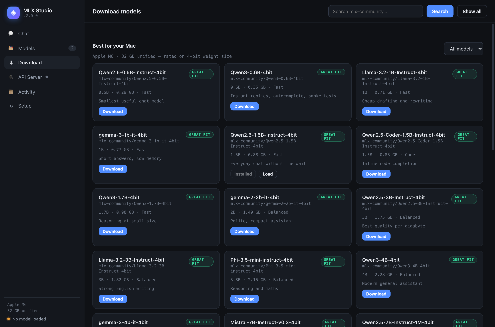

# MLX Studio

**A native macOS app for running local AI models on Apple Silicon — LM Studio / Ollama style, built on Apple's MLX.**

[](https://github.com/DipeshPansuriya/MLX_Model_App/releases/latest)
[](#requirements)
[](#requirements)
[](#license)
[](https://github.com/DipeshPansuriya/MLX_Model_App/stargazers)

MLX Studio wraps Apple's MLX runtime in a desktop UI: load a model, chat with
streaming replies, download and delete weights, serve an OpenAI-compatible API
for Claude Code or DeepSeek, and review a day-to-day activity log. It also
reports installed versions and tells you when updates are available.


---

## Install

Two routes. Both end with the same app in `/Applications`. The first never shows
a Gatekeeper dialog; the second needs one extra command.

### Option A — one-line installer (no Gatekeeper prompt)

```bash
curl -fsSL https://raw.githubusercontent.com/DipeshPansuriya/MLX_Model_App/main/scripts/install.sh | bash
```

That downloads the latest DMG, verifies its SHA-256 against
[`release/latest.json`](release/latest.json), installs to `/Applications`,
checks the signature, and opens the app. No dialog, no Apple Developer account.

Options: `--version 2.0.3`, `--dir ~/Applications`, `--no-launch`. Pass them
after `bash -s --`:

```bash
curl -fsSL https://raw.githubusercontent.com/DipeshPansuriya/MLX_Model_App/main/scripts/install.sh \
  | bash -s -- --version 2.0.3 --no-launch
```

Why this works: the app is ad-hoc signed, not notarised. A **browser** download
carries `com.apple.quarantine`, and macOS 15+ refuses to launch it — the dialog
offers only **Done** and **Move to Bin**. `curl` sets no quarantine flag, so the
check never fires. See [ADR-007](docs/adr/ADR-007-adhoc-signing.md).

### Option B — download the DMG and run it

Downloading through a browser always attaches a quarantine flag. Clear it on the
**DMG**, before you open it — that is the whole trick.

**Step 1 — download.** Go to
[**Releases**](https://github.com/DipeshPansuriya/MLX_Model_App/releases/latest)
and click **`MLX.Studio-2.0.3.dmg`**. It lands in `~/Downloads`.

**Step 2 — clear the flag on the DMG.** Open **Terminal** (⌘-Space, type
`Terminal`) and paste:

```bash
xattr -dr com.apple.quarantine ~/Downloads/MLX.Studio-2.0.3.dmg
```

No output means it worked. Confirm with:

```bash
xattr -l ~/Downloads/MLX.Studio-2.0.3.dmg
```

There should be **no** `com.apple.quarantine` line in the output.

**Step 3 — mount the DMG.** Double-click `MLX.Studio-2.0.3.dmg` in Finder. A
volume named **MLX Studio 2.0.3** appears in the sidebar and on the Desktop. It
contains three items:

```
MLX Studio.app      the application
Applications        a shortcut to your Applications folder
Read Me.txt         the same instructions as this section
```

**Step 4 — drag it across.** Drag **MLX Studio** onto the **Applications**
shortcut in the same window. Finder copies the bundle to `/Applications`. This
takes a second or two; the DMG window does not close by itself.

**Step 5 — eject the DMG.** Click the ⏏ next to **MLX Studio 2.0.3** in the
Finder sidebar. The app does not run from the DMG; it runs from
`/Applications`.

**Step 6 — launch.** Open **Applications** and double-click **MLX Studio**. The
window opens at 1360×900 and the sidebar shows `v2.0.3`.

**Step 7 — confirm it is running.** The sidebar status pill turns green with the
model name, or shows `No model loaded` until you pick one. From Terminal:

```bash
curl -s http://127.0.0.1:8765/api/ping
# {"ok": true, "app": "2.0.3"}
```

#### If you skipped step 2

macOS shows **"MLX Studio" Not Opened** — *"Apple could not verify "MLX
Studio.app" is free of malware…"* with only **Done** and **Move to Bin**. The app
is fine; the flag is still attached. Clear it on the installed copy and relaunch:

```bash
xattr -dr com.apple.quarantine "/Applications/MLX Studio.app"
open "/Applications/MLX Studio.app"
```

The GUI equivalent, if you prefer not to use Terminal:

| macOS | Route |
|---|---|
| **15 Sequoia or newer** (incl. 26, 27) | **System Settings → Privacy & Security → Security → Open Anyway**, authenticate, confirm **Open** |
| **14 Sonoma or older** | Right-click the app → **Open** → **Open** |

Control-click → Open was removed in macOS 15, so it does nothing on current
systems. See [RUNBOOK §4.7](docs/RUNBOOK.md) for the full diagnosis.

#### Uninstall

```bash
rm -rf "/Applications/MLX Studio.app"
```

Model weights stay in `~/.cache/huggingface/hub/`; logs stay in
`~/.mlx_studio/`. Remove those too if you want a clean slate.

### Run from source

```bash
git clone https://github.com/DipeshPansuriya/MLX_Model_App.git
cd MLX_Model_App
./run.sh
```

`Run_MLX_Manager.command` is the double-clickable Finder launcher.

---

## Requirements

| | |
|---|---|
| OS | macOS 12+ on Apple Silicon (M1–M4) |
| Python | 3.10+ — [python.org](https://www.python.org/downloads/macos/) or `brew install python` |
| Packages | `mlx`, `mlx-lm` — installed from the in-app **Setup** tab |
| Optional | `pywebview` for the native window (falls back to the browser) |

```bash
python3 -m pip install pywebview
```

---

## Screens

| Chat | Models |
|---|---|
|  |  |

| Download — best for your Mac | API Server — background mode |
|---|---|
|  |  |

| Activity — log folder and export | Setup |
|---|---|
|  |  |

---

## Features

### Chat
- Load / unload models in-process with a live state pill: `Not loaded` →
  pulsing `Loading…` → green `Loaded — <model>`.
- Token-by-token streaming; each turn reports `tokens · tok/s · GB peak`.
- **Stop** cancels generation, **New chat** resets history.
- `Enter` sends, `Shift+Enter` inserts a newline; the composer grows as you type.

### Models
- Card per cached model with size and repo id.
- **Load**, **Reveal**, **Delete** (blocked while the model is loaded).

### Download
- **Best for your Mac** — a curated catalogue of 25 `mlx-community` models, each
  rated against this machine's unified memory: `great fit`, `good fit`,
  `tight fit` or `too large`. Ratings use the measured 4-bit weight size, not the
  parameter count, because that is what has to fit in RAM.
- Filter by fit band or by category (`Fast`, `Balanced`, `Quality`, `Code`,
  `Reasoning`, `Heavy`).
- Search the [`mlx-community`](https://huggingface.co/mlx-community) org on
  Hugging Face, or browse everything.
- Per-model download status: `running` / `success` / `failed`.

### API Server
- Starts `mlx_lm server` on `http://127.0.0.1:8080/v1`.
- Live server output, copyable endpoint, ready-to-run `curl` example.
- **Background** checkbox — the server detaches into its own session and keeps
  serving after the window closes. Its pid is written to
  `~/.mlx_studio/server.pid`, so the next launch adopts the running server
  instead of starting a second one.
- **Down notification** — a watchdog polls the server every 2 s. If it dies, the
  Server view shows a red banner with the exit status and a **Restart** button, a
  desktop notification fires, and `app.log` records `api server died`.

### Activity
- Filterable log of every chat, load, download, delete, install and server event.
- Persisted to `~/.mlx_studio/logs/activity.log` (one JSON object per line).
- **Export diagnostics** downloads a zip of the whole log folder plus an
  environment report — one file to attach to a GitHub issue.

### Setup
- Installed versions of MLX, MLX-LM and huggingface-hub, each with a pill:
  `up to date`, `update → <version>`, or `missing`.
- App version, latest release, update channel, hardware and last-check time.
- **Check for updates** re-queries PyPI; a `!` badge marks the nav item when
  anything is outdated.
- **Install / Update** runs pip and streams output into the panel.

---

## Version and update checks

| Component | Source of truth |
|---|---|
| MLX Studio | `APP_VERSION` in [`app.py`](app.py) |
| MLX / MLX-LM | `importlib.metadata` vs. the PyPI JSON API |
| App updates | `MLX_STUDIO_UPDATE_URL` release manifest |

Installed copies check for a newer release by fetching a small JSON manifest:

```json
{
  "version": "2.1.0",
  "url": "https://github.com/DipeshPansuriya/MLX_Model_App/releases/download/v2.1.0/MLX.Studio-2.1.0.dmg",
  "sha256": "…",
  "notes": "Faster model loading",
  "published": "2026-11-24T22:00:00Z"
}
```

Point the app at it:

```bash
export MLX_STUDIO_UPDATE_URL="https://raw.githubusercontent.com/DipeshPansuriya/MLX_Model_App/main/release/latest.json"
```

When the manifest version is newer, Setup shows an **App update available**
panel with the release notes and a **Download DMG** button.

---

## Build a DMG

```bash
cd packaging
./build_app.sh              # dist/MLX Studio.app + dist/MLX Studio-<version>.dmg
./build_app.sh --app-only   # app bundle only
./build_app.sh --no-sign    # skip ad-hoc codesigning
```

The script reads `APP_VERSION` from `app.py`, generates `Info.plist`, embeds the
icon, ad-hoc signs the bundle, and produces a compressed DMG with an
`Applications` symlink and a `Read Me.txt`.

Generate the update manifest for a release:

```bash
./release_manifest.py \
  --dmg "../dist/MLX.Studio-2.0.0.dmg" \
  --url "https://github.com/DipeshPansuriya/MLX_Model_App/releases/download/v2.0.0/MLX.Studio-2.0.0.dmg" \
  --notes "Initial packaged release" \
  --out ../release/latest.json
```

---

## Connect Claude Code / DeepSeek

1. Start a model in the **API Server** tab.
2. Point any OpenAI-compatible client at it:

```
Base URL: http://127.0.0.1:8080/v1
API Key:  local
Model:    <the model you started>
```

```bash
export OPENAI_BASE_URL="http://127.0.0.1:8080/v1"
export OPENAI_API_KEY="local"
export OPENAI_MODEL_NAME="mlx-community/Qwen2.5-7B-Instruct-1M-4bit"
```

```bash
curl http://127.0.0.1:8080/v1/chat/completions \
  -H "Content-Type: application/json" \
  -d '{"model":"mlx-community/Qwen2.5-7B-Instruct-1M-4bit",
       "messages":[{"role":"user","content":"Hello!"}]}'
```

---

## Model sizing for 32 GB unified memory

| Model | Download | Peak RAM | Use |
|---|---|---|---|
| `mlx-community/Llama-3.2-3B-Instruct-4bit` | ~2 GB | ~2 GB | fastest replies |
| `mlx-community/Qwen2.5-7B-Instruct-1M-4bit` | ~4 GB | ~4.4 GB | **recommended default** |
| `mlx-community/Qwen3.5-9B-4bit` | ~5–6 GB | ~6 GB | step up in quality |
| `mlx-community/Qwen3.8-27B-4bit` | ~16 GB | ~17 GB | strongest that still fits |

---

## Documentation

Full product, architecture and operational documentation lives in [`docs/`](docs/README.md).

| Document | Answers |
|---|---|
| [docs/PRD.md](docs/PRD.md) | What the product is, users, scope, 32 acceptance criteria, open decisions |
| [docs/ARCHITECTURE.md](docs/ARCHITECTURE.md) | Processes, threads, state, data model, request paths |
| [docs/DESIGN.md](docs/DESIGN.md) | Layout, design tokens, state vocabulary, screen specs, accessibility |
| [docs/DEPLOYMENT.md](docs/DEPLOYMENT.md) | Bundle layout, build, signing, DMG, release, rollback |
| [docs/SECURITY.md](docs/SECURITY.md) | Threat model, trust boundaries, controls, accepted risks |
| [docs/SECURITY-AUDIT.md](docs/SECURITY-AUDIT.md) | 2026-11-24 audit: 21 checks, 3 findings remediated, re-run procedure |
| [docs/PUSH-POLICY.md](docs/PUSH-POLICY.md) | No-credential rule, 19 secret rules, git hooks, CI enforcement |
| [docs/BRANCH-POLICY.md](docs/BRANCH-POLICY.md) | **All branch, tag, scanning and CI policy in one document** — in force, planned, cost |
| [docs/GITHUB-POLICY.md](docs/GITHUB-POLICY.md) | Detailed ruleset and workflow reference |
| [docs/REPO-HARDENING-CHECKLIST.md](docs/REPO-HARDENING-CHECKLIST.md) | Reusable 79-item hardening checklist for any repository |
| [docs/TESTING.md](docs/TESTING.md) | What was verified, measurements, defects found, gaps |
| [docs/RUNBOOK.md](docs/RUNBOOK.md) | Start/stop, health checks, recovery, release checklist |
| [docs/adr/](docs/adr/README.md) | 8 architecture decision records with rejected alternatives |
| [docs/diagrams/](docs/diagrams/README.md) | 6 Mermaid diagrams: runtime, chat flow, lifecycle, release, updates, state |

---

## Project layout

```
MLX_Model_App/
├── app.py                      # backend: HTTP + JSON/SSE API, native window host
├── ui/
│   ├── index.html              # single-page interface
│   ├── style.css               # dark LM Studio–style theme
│   └── app.js                  # routing, streaming, polling
├── packaging/
│   ├── build_app.sh            # .app + .dmg builder
│   ├── launcher.py             # bundle entry point
│   ├── release_manifest.py     # update manifest generator
│   ├── icon.html               # icon source
│   ├── icon_1024.png           # rendered icon
│   └── AppIcon.icns            # compiled icon
├── scripts/
│   ├── security_audit.sh       # re-runnable security checks
│   ├── check_secrets.py        # 19-rule credential scanner
│   └── install_hooks.sh        # activate git hooks
├── .githooks/                  # pre-commit, pre-push
├── .github/                    # workflows, CODEOWNERS, dependabot, issue and PR templates
├── docs/                       # PRD, architecture, design, ADRs, diagrams
├── release/
│   └── latest.json             # update manifest served to installed copies
├── screenshots/                # captured views
├── Run_MLX_Manager.command     # Finder launcher
├── run.sh                      # terminal launcher
├── requirements.txt            # pins for pip-audit and Dependabot
├── CHANGELOG.md
├── CODE_OF_CONDUCT.md
├── CONTRIBUTING.md
├── SECURITY.md
└── LICENSE
```

## Security

```bash
./scripts/install_hooks.sh           # activate pre-commit and pre-push hooks
./scripts/check_secrets.py           # scan the working tree
./scripts/check_secrets.py --all-history
./scripts/security_audit.sh          # 21 checks, exit 0 on pass
./scripts/security_audit.sh --quick  # skip the dependency scan
```

**No credential may enter the repository.** Enforced at three points: pre-commit
(staged content), pre-push (commits leaving the machine), and CI (working tree
plus full history). 19 rules cover platform tokens, key material, generic
assignments and connection strings. See
[docs/PUSH-POLICY.md](docs/PUSH-POLICY.md) and
[docs/SECURITY-AUDIT.md](docs/SECURITY-AUDIT.md).

**`main` is protected.** A ruleset requires a pull request and seven green status
checks, forbids direct pushes, force-pushes and deletion, and has no bypass
actors. An automated review comment reports lint, format, secret, link and syntax
results on every PR. See [docs/GITHUB-POLICY.md](docs/GITHUB-POLICY.md).

---

## HTTP API

| Method | Path | Purpose |
|---|---|---|
| GET | `/api/state` | Full snapshot (app, versions, models, loaded, server, downloads, install) |
| GET | `/api/models` | Installed models |
| GET | `/api/search?q=` | Search mlx-community |
| GET | `/api/logs` | Activity entries |
| GET | `/api/logs/app?limit=` | Application log (startup, HTTP errors, worker failures) |
| GET | `/api/logs/files` | Files in the log folder with size and mtime |
| GET | `/api/logs/export` | Zip of the log folder + `environment.json` |
| GET | `/api/environment` | Versions, paths, hardware, installed model ids |
| GET | `/api/catalog` | Curated models rated against this machine's RAM |
| GET | `/api/versions` | Re-check PyPI, then return versions |
| POST | `/api/load` `{repo}` | Load a model |
| POST | `/api/unload` | Unload and clear the MLX cache |
| POST | `/api/chat` `{messages}` | SSE stream: `token`, `done`, `error` |
| POST | `/api/chat/stop` | Cancel generation |
| POST | `/api/download` `{repo}` | Start a download |
| POST | `/api/delete` `{repo}` | Delete a cached model |
| POST | `/api/server/start` `{repo, background}` | Start the OpenAI-compatible server |
| POST | `/api/server/stop` | Stop it |
| POST | `/api/server/notice/clear` | Dismiss the "server stopped" banner |
| POST | `/api/install` `{kind}` | `install` \| `update` \| `reinstall` |
| POST | `/api/logs/clear` | Truncate the activity log |

---

## Storage

| What | Where |
|---|---|
| Model weights | `~/.cache/huggingface/hub/models--<org>--<name>/` |
| Log folder | `~/.mlx_studio/logs/` |
| Activity log | `~/.mlx_studio/logs/activity.log` |
| Application log | `~/.mlx_studio/logs/app.log` |
| Launch log | `~/.mlx_studio/logs/launch.log` |
| Background server output | `~/.mlx_studio/logs/server.log` |
| Background server pid | `~/.mlx_studio/server.pid` |

Logs rotate at 2 MB with three backups, and the folder is `0700` with `0600`
files because `activity.log` records prompts.

### Sharing logs for an issue

**Activity → Export diagnostics** writes one zip:

```
mlx-studio-diagnostics-YYYYMMDD-HHMMSS.zip
├── environment.json     versions, paths, hardware, installed model ids
└── logs/                activity.log, app.log, launch.log, server.log
```

Attach that file to a
[GitHub issue](https://github.com/DipeshPansuriya/MLX_Model_App/issues/new?template=bug_report.md).
It contains your prompts — skim it before posting. The equivalent from a shell:

```bash
cd ~/.mlx_studio && zip -r ~/mlx-studio-logs.zip logs
```

---

## Troubleshooting

**"MLX Studio" Not Opened / "Apple could not verify…"** — expected on an
ad-hoc-signed build downloaded through a browser. Fix it without any prompt:

```bash
xattr -dr com.apple.quarantine ~/Downloads/MLX.Studio-<version>.dmg
```

then reinstall. Or allow it once via **System Settings → Privacy & Security →
Open Anyway** (macOS 15+), or right-click → **Open** on macOS 14 and older. The
one-line installer avoids the dialog entirely — see [Install](#install). For a
permanently trusted build, sign with a Developer ID and notarise (PRD OD-1).

**No native window** — `python3 -m pip install pywebview`; otherwise the app
opens in your default browser.

**Port 8765 busy** — another MLX Studio instance is running; quit it first.

**Port 8080 busy** — stop the other server before starting the API server.

**Update check says "unknown"** — the PyPI request failed; check network/proxy.
The app injects `truststore` to fix macOS certificate chains.

**Delete refused** — unload the model in Chat first.

---

## Contributing

Issues and pull requests are welcome. Please run `python3 -m py_compile app.py`
and `node --check ui/app.js` before opening a PR.

---

## License

[MIT](LICENSE) © Dipesh Pansuriya
