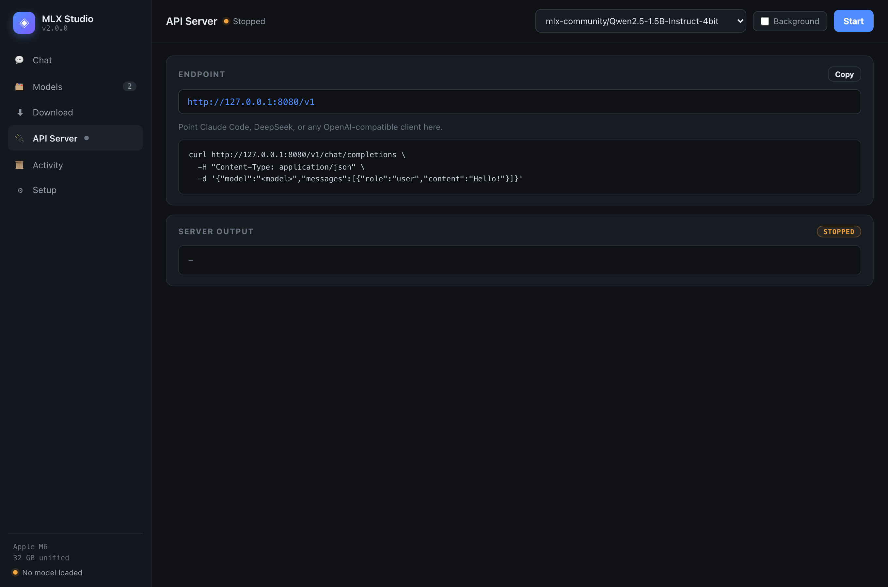

# MLX Studio

**A native macOS app for running local AI models on Apple Silicon — LM Studio / Ollama style, built on Apple's MLX.**

[](https://github.com/DipeshPansuriya/MLX_Model_App/releases/latest)
[](#requirements)
[](#requirements)
[](#license)
[](https://github.com/DipeshPansuriya/MLX_Model_App/stargazers)

MLX Studio wraps Apple's MLX runtime in a desktop UI: load a model, chat with
streaming replies, download and delete weights, serve an OpenAI-compatible API
for DeepSeek Harness or any OpenAI-compatible client, and review a day-to-day
activity log. It also reports installed versions and tells you when updates are
available.

> The [latest release](https://github.com/DipeshPansuriya/MLX_Model_App/releases/latest)
> is **2.0.13** (2026-11-28). Read
> [what is no longer protected](#protections-removed-in-2013) before you use it.
> Text that says **2.0.9** describes that older release ([CHANGELOG](CHANGELOG.md)).
> The screenshots show an earlier version.


---

## Install

Three routes. All end with the same app in `/Applications`.

### Option A: one-line installer

```bash
curl -fsSL https://raw.githubusercontent.com/DipeshPansuriya/MLX_Model_App/main/scripts/install.sh | bash
```

It downloads the DMG of the latest release, checks its SHA-256 against the line
for that exact file in `release/SHA256SUMS` on `main`, copies the new app next to
the old one, checks the signature, then swaps them and opens the app.

| Note | Detail |
|---|---|
| Fails closed | No checksum line for the file, or a mismatch, means nothing is installed |
| Availability | Needs a line for the version in `release/SHA256SUMS` on `main`. The file lists the 2.0.9 and 2.0.13 dmg and pkg. 2.0.8 and older, and 2.0.10 to 2.0.12, are not listed ([release steps](docs/DEPLOYMENT.md)). Versions with no line are refused |
| Signature | Ad-hoc: it detects a damaged bundle, not who published it |
| Options | `--version <x.y.z>`, `--dir ~/Applications`, `--no-launch` |

Pass options after `bash -s --`:

```bash
curl -fsSL https://raw.githubusercontent.com/DipeshPansuriya/MLX_Model_App/main/scripts/install.sh \
  | bash -s -- --dir ~/Applications --no-launch
```

`curl` sets no quarantine flag, so macOS does not show the "Not Opened" dialog.
See [ADR-007](docs/adr/ADR-007-adhoc-signing.md).

### Option B: pkg

Download `MLX.Studio-<version>.pkg` from
[**Releases**](https://github.com/DipeshPansuriya/MLX_Model_App/releases/latest)
and double-click it. It installs to `/Applications`, and the installed app carries
no quarantine flag. The package itself is not signed: how current macOS treats a
browser-downloaded copy of it is not verified. If macOS blocks it, use
**System Settings → Privacy & Security → Open Anyway**.

### Option C: DMG

A browser download carries `com.apple.quarantine`. Clear it on the DMG before you
open it. Replace `<version>` with the downloaded version.

```bash
xattr -dr com.apple.quarantine ~/Downloads/MLX.Studio-<version>.dmg
```

Then double-click the DMG, drag **MLX Studio** onto the **Applications** shortcut,
eject the DMG and open the app from Applications.

### Check that it is running

```bash
curl -s http://127.0.0.1:8765/api/ping
# {"ok": true, "app": "<version>"}
```

#### If macOS says "Not Opened"

The quarantine flag is still attached. Clear it on the installed copy:

```bash
xattr -dr com.apple.quarantine "/Applications/MLX Studio.app"
open "/Applications/MLX Studio.app"
```

The GUI equivalent:

| macOS | Route |
|---|---|
| **15 Sequoia or newer** | **System Settings → Privacy & Security → Security → Open Anyway**, authenticate, confirm **Open** |
| **14 Sonoma or older** | Right-click the app → **Open** → **Open** |

See [RUNBOOK §4.7](docs/RUNBOOK.md) for the full diagnosis.

#### Uninstall

```bash
rm -rf "/Applications/MLX Studio.app"
```

Model weights stay in the Hugging Face cache and logs in `~/.mlx_studio/`.
Remove those too if you want a clean slate.

### Run from source

```bash
git clone https://github.com/DipeshPansuriya/MLX_Model_App.git
cd MLX_Model_App
./run.sh
```

`Run_MLX_Manager.command` is the double-clickable Finder launcher.

---

## Requirements

| | |
|---|---|
| OS | macOS 12+ on Apple Silicon. The launcher is built for 12.0; macOS 12 was not tested, and the MLX packages may need a newer macOS (not verified) |
| Python | 3.10+ from [python.org](https://www.python.org/downloads/macos/) or `brew install python` |
| Packages | `mlx`, `mlx-lm`, installed from the in-app **Setup** tab at the pinned versions |
| Optional | `pywebview` for the native window (falls back to the browser) |

```bash
python3 -m pip install pywebview
```

A system-managed Python (for example Homebrew) may refuse `pip`. Create a virtual
environment (`python3 -m venv ~/mlx-venv`) and run the app from source with it.
The double-clicked app does not look in that folder.

---

## Screens

| Chat | Models |
|---|---|
|  |  |

| Download — best for your Mac | API Server — background mode |
|---|---|
|  |  |

| Activity — log folder and export | Setup |
|---|---|
|  |  |

---

## Features

### Chat
Since 2.0.13, Chat asks the running API server; the app loads no model of its
own. Earlier releases load a second copy for Chat.

- Start the API server first. While it is stopped, Chat says so and offers
  **Go to API Server**; while it starts or restarts, typing is off.
- The **Model** list holds only the served model, already selected.
- Streaming replies. A reply's reasoning sits in a collapsed **Thinking** block
  above the answer.
- Under each reply, a small line: reply size, time to the first answer, writing
  speed, prompt size and the performance mode. The counts come from the API
  server, the times from this app. A figure that is not known is left out.
- The top of the page names the mode in force, with a link to **Configuration**.
- A server busy with another client shows a waiting line.
- **Stop** cancels the request on the server, **New chat** resets history.
- `Enter` sends, `Shift+Enter` inserts a newline.
- One reply at a time. A failed turn, or a reply that is only thinking, is removed
  from the history.

#### Saved chats and chat settings
In the 2.0.14 source (unreleased).

- **Save history** (under **History**) is on by default. Each chat is saved after a
  reply as a plain text file in `~/.mlx_studio/chats`, readable only by your user
  account. Anyone who can read your files can read it.
- **History** lists saved chats: open, search titles and messages, rename, delete
  one or all. Nothing expires. Delete removes the file; it is not a secure erase.
- **Temporary** saves nothing. Switching it starts a new chat.
- With **Save history** off, nothing new is saved. Turns sent while it is off are
  **not added** to a chat that is already saved, also after you turn it on again. A
  chat that was never saved is saved whole by the next reply after you turn it on,
  unless it is Temporary.
- A reply that fails or holds only thinking is not saved. If a save fails, Chat says so.
- **Chat settings** apply to one chat: system prompt, max reply tokens (64 to
  131072), temperature (0 to 2) and top p (0.05 to 1). An empty number uses the
  **Configuration** value. For a saved chat, **Save** stores them with it.

### Models
- Card per cached model with its size on disk, repo id and folder path.
- **Reveal** (opens the folder in Finder), **Copy model
  name** (full repo id) and **Delete**.
- Delete is refused while the model is served, starting or
  downloading.
- A partial download shows **incomplete** with **Resume download**.

### Download
- **Best for your Mac**: 25 `mlx-community` models, each rated against this
  machine's unified memory (`great fit`, `good fit`, `tight fit`, `too large`)
  from the 4-bit weight size. The rating does not include context memory.
- Filter by fit band or category, or search the
  [`mlx-community`](https://huggingface.co/mlx-community) organisation.
- Search results use the same cards, with fit and size. Sizes marked (estimate)
  come from the parameter count; missing details show as unknown.
- Progress counted in bytes, current file name, **Cancel**, and an Active
  Downloads section that starts collapsed and shows count and progress. Cancelling inside a Xet-backed file was not tested.

### API Server
Since 2.0.13.

- Starts `mlx_lm server` itself, with no MLX Studio wrapper or proxy, on
  `http://127.0.0.1:8080/v1`, with 8192 reply tokens by default.
- **MLX has no memory limit.** See
  [what is no longer protected](#protections-removed-in-2013).
- One model per server. Live server output, copyable endpoint and `curl` example.
- Warns when the chosen model is marked as unable to call tools.
- **Run in background** (on by default for OptiQ, off for MLX; your choice is kept per
  engine): the server keeps running, and holding memory, until **Stop**, after the window
  closes. A background MLX server has no password and keeps running until **Stop**. Its process
  id is saved in `~/.mlx_studio/server.pid` and adopted on the next launch only if
  the command line and start time still match.
- If the server dies, the view shows a banner with **Restart** and records the
  event. See [the API Server card](#the-api-server-card).

**Start at login** (off by default): set a default model and the server starts when you
log in. OptiQ only, because it needs a password. [How it works](docs/ENGINES.md#start-at-login-2014).

### Configuration
Since 2.0.13. Replaces the Settings box on the API Server card.

- Pick **All models (defaults)** or an installed model. Fields: max context
  (OptiQ only), server reply cap (a default only), Chat reply cap, temperature,
  top-p, and prompt cache size and bytes.
- Each field shows the value that applies; empty means automatic, or under a model
  the All models value. **Save** stores only what you changed; **Reset this
  entry** clears one entry.
- Server settings apply at the next start or **Apply changes**; Chat values apply
  to the next message.
- The memory limit, MLX buffer cache limit and two-model context cap are removed.
- [Keys and ranges](docs/API.md#6b-user-settings).

#### Performance mode (no commands needed)

| Choice | What it does |
|---|---|
| **Standard (recommended)** | Nothing changes |
| **Save memory** | Uses less memory but reads new prompts about half as fast (measured on one model and one Mac). Compression starts after 5,000 tokens; requests are answered one at a time |
| **Advanced** | Three raw settings. 4-bit produced broken answers in testing |

To try a mode:

1. Open **Configuration**. Keep **All models (defaults)**, or pick one model.
2. Choose a **Performance mode**, then press **Save**.
3. Open **API Server** and press **Stop**, then **Start Server** (or **Apply changes**).
4. Open **Chat**, check the mode named at the top, and ask a question. The line
   under the reply shows the speed.
5. To compare memory too, stop the API server, run **Load Test** once in each
   mode, and read the results: each one lists the settings it ran with.

A model that cannot use compressed memory has the choice switched off, with the
reason, and runs in Standard.

### Load Test
Since 2.0.13. Measures one model on this Mac. **One 4096-token run on
OptiQ has passed with a real model; other sizes and MLX have not been tried.** [How to run it safely](docs/RUNBOOK.md#37a-run-a-load-test-safely).

- Tick context sizes (4096 up to 1,048,576) or type your own (up to 12 in one
  test); a size over the model's limit is off. The API server must be stopped; the
  page says so and offers **Stop API server**.
- Large sizes take long (1M can take an hour or more). A size above 32768 tokens
  is stopped after 3600 seconds; fewer rounds make it shorter.
- **Thinking** (on or off) is offered where the model's chat template has the
  `enable_thinking` switch. Thinking uses the reply token budget. Each result says
  which it was.
- Shows live progress and memory, and **Cancel test**.
- **No memory limit:** every chosen size is tried. The test server is still ended
  when macOS reports critical memory pressure, swap grows by more than 0.5 GB,
  memory cannot be read, or memory is not sampled for more than 1 second (for
  example the Mac slept). Memory is sampled, so the Mac can still freeze.
- A model whose own limit is offered as a size (for example 1,000,000) can be
  tested at that limit.
- Results: size, read speed, first-token time, write speed, peak memory and the
  settings used, with earlier runs. Old results are tagged **stale**. A size can
  no longer be applied to the config: MLX has no setting for it.

### Activity
- Filterable log of chats, loads, downloads, deletes, installs and server events.
- **Export diagnostics** downloads a zip of the log folder plus an environment
  report.

### Setup
- Installed versions of MLX, MLX-LM and huggingface-hub.
- **Check for updates** queries PyPI for the latest MLX releases and, if
  configured, the app manifest.
- **Install / Update** runs pip with the pinned `mlx`, `mlx-lm` and
  `huggingface-hub` 2.4.0 versions; a newer installed version is kept.

---

## Version and update checks

| Component | Source of truth |
|---|---|
| MLX Studio | `APP_VERSION` in [`app.py`](app.py) |
| MLX / MLX-LM | `importlib.metadata` vs. the PyPI JSON API |
| App updates | `MLX_STUDIO_UPDATE_URL` release manifest |

Installed copies check for a newer release by fetching a small JSON manifest:

```json
{
  "version": "2.1.0",
  "url": "https://github.com/DipeshPansuriya/MLX_Model_App/releases/download/v2.1.0/MLX.Studio-2.1.0.pkg",
  "notes": "Example release notes",
  "published": "2026-11-24T22:00:00Z",
  "sha256": "<64 hex characters>",
  "size": 1000000
}
```

Point the app at it:

```bash
export MLX_STUDIO_UPDATE_URL="https://raw.githubusercontent.com/DipeshPansuriya/MLX_Model_App/main/release/latest.json"
```

When the manifest version is newer, Setup shows an **App update available** panel
with the release notes, the published SHA-256 and a **Download installer** button
(the published link is the `.pkg`). Only `https` links are opened. The app does not check the downloaded file for you.

---

## Build and release

Needs the Xcode command line tools (`clang`).

```bash
./packaging/build_app.sh              # app, dmg, pkg and dist/SHA256SUMS
./packaging/build_app.sh --app-only   # app bundle only
./packaging/build_app.sh --no-sign    # skip ad-hoc codesigning
```

The script compiles `packaging/launcher.c` for macOS 12.0 and stops if the binary
reports a different minimum. Since 2.0.10 it also stops if `codesign` fails or
`app.py` lacks exactly one `APP_VERSION = "X.Y.Z"` line. Release files are generated from that exact build
(Python 3.11+), never edited by hand:

```bash
python3 packaging/release_manifest.py --dist dist --notes "<release notes>"
python3 packaging/release_manifest.py --verify --release --dist dist
```

---

## Engines

OptiQ is the default on the API Server and Load Test screens (a saved choice is kept). It can be installed on Setup or from the Start area;
it needs an API key. Both lack protections that earlier releases had; the card lists
them. See [docs/ENGINES.md](docs/ENGINES.md).

## Connect DeepSeek Harness or any OpenAI-compatible client

The MLX server offers the OpenAI-style API only. It has no
`/v1/messages` route, so a client that speaks only the Anthropic API (such as Claude
Code) cannot connect to it directly. OptiQ has that route, switched on by default; see
[docs/ENGINES.md](docs/ENGINES.md) (tried once with Claude Code 2.1.332).

1. Download the model in MLX Studio, then start it in the **API Server** tab.
2. Point the client at it:

```
Base URL: http://127.0.0.1:8080/v1
API Key:  local            (any value; the server does not check it)
Model:    default_model
```

```bash
curl http://127.0.0.1:8080/v1/chat/completions \
  -H "Content-Type: application/json" \
  -d '{"model":"default_model",
       "messages":[{"role":"user","content":"Hello!"}]}'
```

`default_model` is the model the server was started with. The exact started model id
works too. **Any other name makes `mlx_lm` load that model in its place**, from the
local cache or from a local folder path. The app starts the server offline, so
nothing is downloaded.

## Protections removed in 2.0.13

Since 2.0.13, MLX Studio's request guard and its 80% memory rule are
gone; the MLX engine is `mlx_lm`'s own server.

| Removed | Effect now |
|---|---|
| 80% memory rule and memory-based context limit | A large model or prompt can exhaust memory, freeze or crash the Mac |
| Max context setting and long prompt refusal (MLX) | The app sets no prompt limit. The setting is for OptiQ only (older text is dropped) |
| Reply token cap | The setting is a default; a request may ask for more |
| Two models in one server | One model |
| MLX buffer cache limit setting | Gone |
| `Host`, JSON-only and `Origin` checks on port 8080 | Only `--allowed-origins`: it limits which web pages can read replies. It does not stop them sending requests, and it does not stop DNS rebinding, through which a website may read replies and the list of downloaded models |
| Request size limits | Gone |
| Refusal of other models, draft models, adapters and file paths | Any local program, and a web page, can make the server load another cached model, a local folder, an adapter or a draft model |
| Null tool argument fix | Gone |
| Loaded model and memory readout | Delete is refused only for the model the server was started with |
| Default prompt cache of 2 conversations with a byte cap | `mlx_lm`'s default (10), no byte cap unless set |
| Memory stop under OptiQ | The server is not stopped for memory |
| Load Test size gate, 80% limit, memory estimates and **Apply this size to config** | Every size is tried |

Still in place: both engines listen on `127.0.0.1` only; MLX gets
`--allowed-origins` set to the app's origin and no `--trust-remote-code`; the server
process gets a minimal environment with Hugging Face offline; OptiQ keeps its API key
and port check; keys are hidden in the server log; leftover server processes are
cleaned up; the app's own pages on port 8765 keep their request checks and token.

### Tool calling

| Model | Tool calls | Basis (2026-11-25, mlx_lm 0.32.2) |
|---|---|---|
| `mlx-community/Qwen2.5-7B-Instruct-1M-4bit` | **Yes (verified)** | 60 of 60 tool probes returned `tool_calls` |
| `mlx-community/Qwen2.5-Coder-7B-Instruct-4bit` | **No** | Writes the call as plain text; the client gets no tool call |
| `mlx-community/DeepSeek-R1-Distill-Qwen-7B-4bit` | No | Its cached chat template has no tools; not run |
| Others | Unknown | Not checked |

These are measurements on one Mac, not repeated for every release. With a large
tool list (35 tools) the verified model answered a bare greeting with a tool call
in 8 of 8 tries. Adding this instruction to the client gave plain text in 24 of 24:
`For greetings or chat, answer in plain text without calling any tool.`

### Context window

Set this in the client. The MLX server has no context-size setting and does not
reject long input; too much context can freeze or crash the Mac, or lower quality.

| Model | Recommended | In tokens |
|---|---|---|
| `Qwen2.5-7B-Instruct-1M-4bit` | **96K** | 98304 |
| `Qwen2.5-Coder-7B-Instruct-4bit` | **32K** (model limit) | 32768 |

The figures are for a 32 GB Mac and are **calculated from measured bytes per
token, not load-tested**. They include the reply. 500K or 1M context is not
proven and is not recommended here.

### The API Server card

**Since 2.0.13.**

| Part | Behaviour |
|---|---|
| **Model** | One model with a remove button. With one chosen, **+ Add model** is off and says why |
| When the app opens | With the server stopped, the model of the last start that reported ready is already chosen. A model no longer installed completely is left out. Nothing starts by itself |
| While a server runs | The card shows what it was started with. Your edit stays until you apply it or a new server starts |
| **Restart** | After the server stops unexpectedly or cannot start: starts the model and mode that last ran, not an unapplied choice |
| **Start Server** | Off, with the reason shown, when no model is chosen or the engine cannot serve it |
| **Apply changes** | On a running server, enabled when the model, engine, **Background** or saved server settings differ. It restarts the server, so **a reply in progress is interrupted** |
| Failed Apply | If the new server cannot be started, cannot load its model or is not ready in time, the previous model is started again once and **Changes not applied** says why |
| Not ready in 600 seconds | MLX and OptiQ: the app **stops** a server that has not reported ready within 600 seconds, and starts the replaced one again. A very large model on a slow disk can hit this. The same applies to a server kept from an earlier run of the app, also when it cannot be checked who holds its port |
| **Stop** | Stops the server, also while it is starting, and forgets the fallback |

## Model sizing

| Model | 4-bit weights | Use |
|---|---|---|
| `mlx-community/Llama-3.2-3B-Instruct-4bit` | 1.82 GB | faster replies |
| `mlx-community/Qwen2.5-7B-Instruct-1M-4bit` | 4.3 GB | **recommended default**, tool calling verified |
| `mlx-community/Qwen3-14B-4bit` | 8.32 GB | step up in size |
| `mlx-community/Qwen3-30B-A3B-4bit` | 17.19 GB | large; little room for context on 32 GB |

Weight sizes come from the app catalogue. Running memory is higher and grows with
context length.

---

## Documentation

Full product, architecture and operational documentation lives in [`docs/`](docs/README.md).

| Document | Answers |
|---|---|
| [docs/PRD.md](docs/PRD.md) | What the product is, users, scope, 32 acceptance criteria, open decisions |
| [docs/ARCHITECTURE.md](docs/ARCHITECTURE.md) | Processes, threads, state, data model, request paths |
| [docs/DESIGN.md](docs/DESIGN.md) | Layout, design tokens, state vocabulary, screen specs, accessibility |
| [docs/DEPLOYMENT.md](docs/DEPLOYMENT.md) | Bundle layout, build, signing, DMG, pkg, release, rollback |
| [docs/SECURITY.md](docs/SECURITY.md) | Threat model, trust boundaries, controls, accepted risks |
| [docs/SECURITY-AUDIT.md](docs/SECURITY-AUDIT.md) | 2026-11-24 audit record and re-run procedure |
| [docs/PUSH-POLICY.md](docs/PUSH-POLICY.md) | No-credential rule, 19 secret rules, git hooks, CI enforcement |
| [docs/BRANCH-POLICY.md](docs/BRANCH-POLICY.md) | **All branch, tag, scanning and CI policy in one document** — in force, planned, cost |
| [docs/GITHUB-POLICY.md](docs/GITHUB-POLICY.md) | Detailed ruleset and workflow reference |
| [docs/REPO-HARDENING-CHECKLIST.md](docs/REPO-HARDENING-CHECKLIST.md) | Reusable 79-item hardening checklist for any repository |
| [docs/TESTING.md](docs/TESTING.md) | What was verified, measurements, defects found, gaps |
| [docs/RUNBOOK.md](docs/RUNBOOK.md) | Start/stop, health checks, recovery, release checklist |
| [docs/API.md](docs/API.md) | App endpoints, request rules, chat stream |
| [docs/DATABASE.md](docs/DATABASE.md) | No database: files, logs, retention |
| [docs/implementation/](docs/implementation/Setup-Initialisation.md) | [Setup](docs/implementation/Setup-Initialisation.md), [features](docs/implementation/Feature-Development.md), [auth and security](docs/implementation/Authentication-Security.md), [MCP](docs/implementation/MCP-Connection.md), [integrations](docs/implementation/Integrations.md), [testing and debugging](docs/implementation/Testing-QA-Debugging.md) |
| [docs/AGENTS.md](docs/AGENTS.md) | Who owns which area |
| [docs/AI-PROMPTS.md](docs/AI-PROMPTS.md) | Suggested prompts for AI coding assistants |
| [docs/Project_Summary.md](docs/Project_Summary.md) | One-page system summary and open risks |
| [docs/adr/](docs/adr/README.md) | 12 architecture decision records with rejected alternatives |
| [docs/diagrams/](docs/diagrams/README.md) | 6 Mermaid diagrams: runtime, chat flow, lifecycle, release, updates, state |

---

## Project layout

```
MLX_Model_App/
├── app.py                      # backend: HTTP + JSON/SSE API, native window host
├── model_info.py               # model facts: context limit, weight size, compression
├── ui/
│   ├── index.html              # single-page interface
│   ├── style.css               # dark LM Studio–style theme
│   └── app.js                  # routing, streaming, polling
├── packaging/
│   ├── build_app.sh            # .app, .dmg and .pkg builder
│   ├── launcher.c              # bundle entry point, compiled by the build
│   ├── release_manifest.py     # release file generator and checker
│   ├── icon.html               # icon source
│   ├── icon_1024.png           # rendered icon
│   └── AppIcon.icns            # compiled icon
├── scripts/
│   ├── install.sh              # one-line installer
│   ├── security_audit.sh       # re-runnable security checks
│   ├── check_docs.py           # documentation link check
│   ├── check_secrets.py        # 19-rule credential scanner
│   └── install_hooks.sh        # activate git hooks
├── .githooks/                  # pre-commit, pre-push
├── .github/                    # workflows, CODEOWNERS, dependabot, issue and PR templates
├── tests/                      # pytest suite
├── docs/                       # PRD, architecture, design, ADRs, diagrams
├── release/
│   ├── latest.json             # update manifest served to installed copies
│   └── SHA256SUMS              # per-file checksums, read by the installer
├── screenshots/                # captured views
├── Run_MLX_Manager.command     # Finder launcher
├── run.sh                      # terminal launcher
├── requirements.txt            # pins for pip-audit and Dependabot
├── CHANGELOG.md
├── CODE_OF_CONDUCT.md
├── CONTRIBUTING.md
├── SECURITY.md
└── LICENSE
```

## Security

```bash
./scripts/install_hooks.sh           # activate pre-commit and pre-push hooks
./scripts/check_secrets.py           # scan the working tree
./scripts/check_secrets.py --all-history
./scripts/security_audit.sh          # exit 0 on pass
./scripts/security_audit.sh --quick  # skip the dependency scan
```

The app API on 8765 checks who is calling: it needs one loopback
`Host` header, a matching `Origin` when one is sent, JSON POSTs and a per-launch
token on every `/api/*` request except `/api/ping` and `/api/focus`. In the 2.0.13
source the MLX server on 8080 has no such checks and no key; see
[protections removed](#protections-removed-in-2013). There is no user
authentication: other programs on the same Mac can use both ports, and in released
builds one can fetch `/` on 8765 to read the token. Chat prompts are not written to
the activity log; saved chats are separate files
([Saved chats](#saved-chats-and-chat-settings)) and are not in the diagnostics export.

**Since 2.0.10:** `/` no longer holds the token (it goes to the
window in the URL fragment), every `Origin` header is checked, and replies carry a
full `Content-Security-Policy`. A POST needs exactly one `Content-Type`, and
`PYWEBVIEW_LOG` is ignored. In browser mode, if the browser cannot be opened, quit
MLX Studio and open it again from its icon. This is still not user
authentication. Remaining limits: [docs/SECURITY.md](docs/SECURITY.md) section 5.

Known open risk: any local program can use port 8080 and make the MLX server load
another model, folder or adapter.

**No credential may enter the repository.** Enforced at three points: pre-commit
(staged content), pre-push (commits leaving the machine), and CI (working tree
plus full history). 19 rules cover platform tokens, key material, generic
assignments and connection strings. See
[docs/PUSH-POLICY.md](docs/PUSH-POLICY.md) and
[docs/SECURITY-AUDIT.md](docs/SECURITY-AUDIT.md).

**`main` is protected.** A ruleset requires a pull request and green status checks
(`scripts/set_approval_gate.sh` lists eight, including `Release consistency`; the
live ruleset was not updated on 2026-11-25), forbids direct pushes, force-pushes and deletion, and has no bypass
actors. An automated review comment reports lint, format, secret, link and syntax
results on every PR. See [docs/GITHUB-POLICY.md](docs/GITHUB-POLICY.md).

---

## HTTP API

App API on `http://127.0.0.1:8765`, used by the window. Every `/api/*` request,
GET and POST, needs the `X-MLX-Token` header (`403` without it); the exceptions
are `GET /api/ping` and `POST /api/focus`. POSTs also need
`Content-Type: application/json`. In 2.0.9 the app puts the token into its page,
which any local program can fetch, so it is not user authentication. Since
2.0.10 the page no longer holds it.

| Method | Path | Purpose |
|---|---|---|
| GET | `/api/ping` | Health and app version |
| GET | `/api/state` | Full snapshot (app, versions, models, loaded, server, downloads, install) |
| GET | `/api/models` | Cached models, with `complete` |
| GET | `/api/search?q=` | Search mlx-community |
| GET | `/api/catalog` | Curated models rated against this machine's RAM |
| GET | `/api/versions` | Re-check PyPI, then return versions |
| GET | `/api/environment` | Versions, paths, hardware, cached model ids |
| GET | `/api/logs` | Activity entries |
| GET | `/api/logs/app?limit=` | Application log |
| GET | `/api/logs/files` | Files in the log folder |
| GET | `/api/logs/export` | Zip of the log folder + `environment.json` |
| POST | `/api/focus` | Raise the window (used by a second launch) |
| POST | `/api/chat` `{repo, messages}` | Asks the running API server. SSE stream: `status`, `reasoning`, `token`, `done` (with the reply's `stats`), `error` |
| POST | `/api/chat/stop` | Cancel generation |
| POST | `/api/download` `{repo}` | Start or resume a download |
| POST | `/api/download/cancel` `{repo}` | Cancel a running download |
| POST | `/api/delete` `{repo}` | Delete a cached model |
| POST | `/api/reveal` `{repo}` | Show a cached model in Finder |
| POST | `/api/server/start` `{repo, background}` | Start the API server with one model |
| POST | `/api/server/stop` | Stop it |
| POST | `/api/server/notice/clear` | Dismiss the "server stopped" banner |
| POST | `/api/install` `{kind}` | `install` \| `update` \| `reinstall` |
| POST | `/api/logs/clear` | Delete the activity log files |

---

## Storage

| What | Where |
|---|---|
| Model weights | `~/.cache/huggingface/hub/models--<org>--<name>/`, or where `HF_HOME` / `HF_HUB_CACHE` point |
| Log folder | `~/.mlx_studio/logs/` |
| Activity log | `~/.mlx_studio/logs/activity.log` |
| Application log | `~/.mlx_studio/logs/app.log` |
| Launch log | `~/.mlx_studio/logs/launch.log` |
| Background server output | `~/.mlx_studio/logs/server.log` |
| Background server pid | `~/.mlx_studio/server.pid` |
| User settings | `~/.mlx_studio/settings.json` |
| Load test results | `~/.mlx_studio/loadtest.json` |
| Last models that started | `~/.mlx_studio/server.last.json` |

Logs rotate at 2 MB with three backups (`server.log` before a background start).
The folder is `0700`. The activity, application, launch and server logs are
created or reset to `0600`. Variables set in a Finder launch environment may
differ from your shell, so check the cache path in `/api/environment` or the
diagnostics export if models seem missing.

### Sharing logs for an issue

**Activity → Export diagnostics** writes one zip:

```
mlx-studio-diagnostics-YYYYMMDD-HHMMSS.zip
├── environment.json     versions, paths, hardware, installed model ids
└── logs/                activity.log, app.log, launch.log, server.log
```

Attach that file to a
[GitHub issue](https://github.com/DipeshPansuriya/MLX_Model_App/issues/new?template=bug_report.md).
Review it before posting: it contains model names, local file paths, error
messages and API server output (a malformed request to port 8080 is logged with
its body). Logs from other builds may hold more. The equivalent from a shell:

```bash
cd ~/.mlx_studio && zip -r ~/mlx-studio-logs.zip logs
```

---

## Troubleshooting

**"MLX Studio" Not Opened / "Apple could not verify…"**: expected on an
ad-hoc-signed build downloaded through a browser. See
[Install](#install). For a permanently trusted build, sign with a Developer ID and
notarise (PRD OD-1).

**Nothing happens on double-click**: read `~/.mlx_studio/logs/launch.log`. The
launcher needs Python 3.10+.

**No native window**: `python3 -m pip install pywebview`; otherwise the app opens
in your default browser.

**"invalid session token; reload the window"**: a window or tab from an earlier
launch. Reload it. Since 2.0.10 the message is **"invalid session
token; open MLX Studio again from its icon"**, and reloading does not help.

**"This page has no session. Open MLX Studio from its app icon."** (since 2.0.10):
the page was opened without the app, for example from a bookmark. Open the app; in
browser mode a second launch opens a new tab (not checked live: if an icon click
only brings the running app forward, quit it and open it again).

**Port 8765 busy**: another program holds it. A second MLX Studio launch only
raises the first window.

**Port 8080 busy**: stop the other server before starting the API server.

**A client shows a tool call as text**: pick a model with verified
[tool calling](#tool-calling).

**Update check says "unknown"**: the request failed; check network or proxy.

**Delete refused**: stop the API server or wait for the download. Only the model
the server was started with is protected; do not delete a model a client has asked
the server to load.

---

## Contributing

Issues and pull requests are welcome. Before opening a PR run:

```bash
python3 -m pytest
ruff check . && ruff format --check .
node --check ui/app.js
python3 scripts/check_docs.py
python3 scripts/check_secrets.py
```

---

## License

[MIT](LICENSE) © Dipesh Pansuriya
