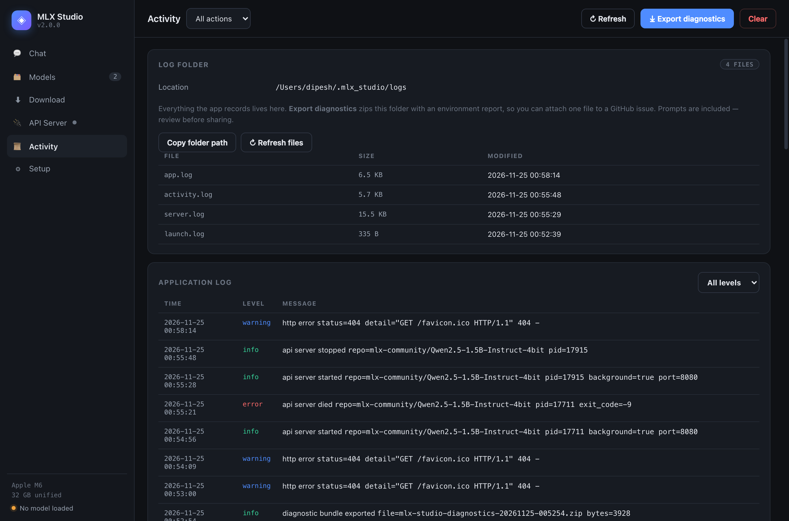

# MLX Studio

**A native macOS app for running local AI models on Apple Silicon — LM Studio / Ollama style, built on Apple's MLX.**

[](https://github.com/DipeshPansuriya/MLX_Model_App/releases/latest)
[](#requirements)
[](#requirements)
[](#license)
[](https://github.com/DipeshPansuriya/MLX_Model_App/stargazers)

MLX Studio wraps Apple's MLX runtime in a desktop UI: load a model, chat with
streaming replies, download and delete weights, serve an OpenAI-compatible API
for DeepSeek Harness or any OpenAI-compatible client, and review a day-to-day
activity log. It also reports installed versions and tells you when updates are
available.

> This page describes the **2.0.9 source**, which is not released yet. The
> screenshots show an earlier version.


---

## Install

Three routes. All end with the same app in `/Applications`.

### Option A: one-line installer

```bash
curl -fsSL https://raw.githubusercontent.com/DipeshPansuriya/MLX_Model_App/main/scripts/install.sh | bash
```

It downloads the DMG of the latest release, checks its SHA-256 against the line
for that exact file in `release/SHA256SUMS` on `main`, copies the new app next to
the old one, checks the signature, then swaps them and opens the app.

| Note | Detail |
|---|---|
| Fails closed | No checksum line for the file, or a mismatch, means nothing is installed |
| Availability | Needs a line for the version in `release/SHA256SUMS` on `main`. The file is not there yet: it starts with the built and verified 2.0.9, and 2.0.8 is not backfilled ([release steps](docs/DEPLOYMENT.md)). Versions with no line are refused |
| Signature | Ad-hoc: it detects a damaged bundle, not who published it |
| Options | `--version <x.y.z>`, `--dir ~/Applications`, `--no-launch` |

Pass options after `bash -s --`:

```bash
curl -fsSL https://raw.githubusercontent.com/DipeshPansuriya/MLX_Model_App/main/scripts/install.sh \
  | bash -s -- --dir ~/Applications --no-launch
```

`curl` sets no quarantine flag, so macOS does not show the "Not Opened" dialog.
See [ADR-007](docs/adr/ADR-007-adhoc-signing.md).

### Option B: pkg

Download `MLX.Studio-<version>.pkg` from
[**Releases**](https://github.com/DipeshPansuriya/MLX_Model_App/releases/latest)
and double-click it. It installs to `/Applications`, and the installed app carries
no quarantine flag. The package itself is not signed: how current macOS treats a
browser-downloaded copy of it is not verified. If macOS blocks it, use
**System Settings → Privacy & Security → Open Anyway**.

### Option C: DMG

A browser download carries `com.apple.quarantine`. Clear it on the DMG before you
open it. Replace `<version>` with the downloaded version.

```bash
xattr -dr com.apple.quarantine ~/Downloads/MLX.Studio-<version>.dmg
```

Then double-click the DMG, drag **MLX Studio** onto the **Applications** shortcut,
eject the DMG and open the app from Applications.

### Check that it is running

```bash
curl -s http://127.0.0.1:8765/api/ping
# {"ok": true, "app": "<version>"}
```

#### If macOS says "Not Opened"

The quarantine flag is still attached. Clear it on the installed copy:

```bash
xattr -dr com.apple.quarantine "/Applications/MLX Studio.app"
open "/Applications/MLX Studio.app"
```

The GUI equivalent:

| macOS | Route |
|---|---|
| **15 Sequoia or newer** | **System Settings → Privacy & Security → Security → Open Anyway**, authenticate, confirm **Open** |
| **14 Sonoma or older** | Right-click the app → **Open** → **Open** |

See [RUNBOOK §4.7](docs/RUNBOOK.md) for the full diagnosis.

#### Uninstall

```bash
rm -rf "/Applications/MLX Studio.app"
```

Model weights stay in the Hugging Face cache and logs in `~/.mlx_studio/`.
Remove those too if you want a clean slate.

### Run from source

```bash
git clone https://github.com/DipeshPansuriya/MLX_Model_App.git
cd MLX_Model_App
./run.sh
```

`Run_MLX_Manager.command` is the double-clickable Finder launcher.

---

## Requirements

| | |
|---|---|
| OS | macOS 12+ on Apple Silicon. The launcher is built for 12.0; macOS 12 was not tested, and the MLX packages may need a newer macOS (not verified) |
| Python | 3.10+ from [python.org](https://www.python.org/downloads/macos/) or `brew install python` |
| Packages | `mlx`, `mlx-lm`, installed from the in-app **Setup** tab at the pinned versions |
| Optional | `pywebview` for the native window (falls back to the browser) |

```bash
python3 -m pip install pywebview
```

A system-managed Python (for example Homebrew) may refuse `pip`. Create a virtual
environment (`python3 -m venv ~/mlx-venv`) and run the app from source with it.
The double-clicked app does not look in that folder.

---

## Screens

| Chat | Models |
|---|---|
|  |  |

| Download — best for your Mac | API Server — background mode |
|---|---|
|  |  |

| Activity — log folder and export | Setup |
|---|---|
|  |  |

---

## Features

### Chat
- Load and unload one model inside the app, with a live state pill.
- Search installed models by name (also on API Server): Up and Down to move,
  Enter to choose, Escape to close. The x clears the search and keeps your choice.
- Token-by-token streaming; each turn reports `tokens · tok/s · GB peak`.
- **Stop** cancels generation, **New chat** resets history.
- `Enter` sends, `Shift+Enter` inserts a newline.
- One reply at a time. Load and Unload are refused while a reply is running. A
  failed turn is removed from the history.

### Models
- Card per cached model with its size on disk, repo id and folder path.
- **Load**, **Unload**, **Reveal** (opens the folder in Finder), **Copy model
  name** (full repo id) and **Delete**.
- Delete is refused while the model is loaded, loading, served, starting or
  downloading.
- A partial download shows **incomplete** with **Resume download**.

### Download
- **Best for your Mac**: 25 `mlx-community` models, each rated against this
  machine's unified memory (`great fit`, `good fit`, `tight fit`, `too large`)
  from the 4-bit weight size. The rating does not include context memory.
- Filter by fit band or category, or search the
  [`mlx-community`](https://huggingface.co/mlx-community) organisation.
- Search results use the same cards, with fit and size. Sizes marked (estimate)
  come from the parameter count; missing details show as unknown.
- Progress counted in bytes, current file name, **Cancel**, and an Active
  Downloads section that starts collapsed and shows count and progress. Cancelling inside a Xet-backed file was not tested.

### API Server
- Starts `mlx_lm server` through MLX Studio's request guard on
  `http://127.0.0.1:8080/v1`, with 8192 reply tokens by default.
- Live server output, copyable endpoint, `curl` example, and the same searchable
  dropdown.
- Warns when the chosen model is marked as unable to call tools.
- **Background**: the server keeps running after the window closes. Its process
  id is saved in `~/.mlx_studio/server.pid` and adopted on the next launch only if
  the command line and start time still match.
- If the server dies, the view shows a banner with **Restart** and records the
  event.

### Activity
- Filterable log of chats, loads, downloads, deletes, installs and server events.
- **Export diagnostics** downloads a zip of the log folder plus an environment
  report.

### Setup
- Installed versions of MLX, MLX-LM and huggingface-hub.
- **Check for updates** queries PyPI for the latest MLX releases and, if
  configured, the app manifest.
- **Install / Update** runs pip with the pinned `mlx`, `mlx-lm` and
  `huggingface-hub` 2.4.0 versions; a newer installed version is kept.

---

## Version and update checks

| Component | Source of truth |
|---|---|
| MLX Studio | `APP_VERSION` in [`app.py`](app.py) |
| MLX / MLX-LM | `importlib.metadata` vs. the PyPI JSON API |
| App updates | `MLX_STUDIO_UPDATE_URL` release manifest |

Installed copies check for a newer release by fetching a small JSON manifest:

```json
{
  "version": "2.1.0",
  "url": "https://github.com/DipeshPansuriya/MLX_Model_App/releases/download/v2.1.0/MLX.Studio-2.1.0.pkg",
  "notes": "Example release notes",
  "published": "2026-11-24T22:00:00Z",
  "sha256": "<64 hex characters>",
  "size": 1000000
}
```

Point the app at it:

```bash
export MLX_STUDIO_UPDATE_URL="https://raw.githubusercontent.com/DipeshPansuriya/MLX_Model_App/main/release/latest.json"
```

When the manifest version is newer, Setup shows an **App update available** panel
with the release notes, the published SHA-256 and a **Download installer** button
(the published link is the `.pkg`). Only `https` links are opened. The app does not check the downloaded file for you.

---

## Build and release

Needs the Xcode command line tools (`clang`).

```bash
./packaging/build_app.sh              # app, dmg, pkg and dist/SHA256SUMS
./packaging/build_app.sh --app-only   # app bundle only
./packaging/build_app.sh --no-sign    # skip ad-hoc codesigning
```

The script compiles `packaging/launcher.c` for macOS 12.0 and stops if the binary
reports a different minimum. Release files are generated from that exact build
(Python 3.11+), never edited by hand:

```bash
python3 packaging/release_manifest.py --dist dist --notes "<release notes>"
python3 packaging/release_manifest.py --verify --release --dist dist
```

---

## Connect DeepSeek Harness or any OpenAI-compatible client

The server offers the OpenAI-style API only. It has no `/v1/messages` route, so a
client that speaks only the Anthropic API (such as Claude Code) cannot connect to
it directly.

1. Download the model in MLX Studio, then start it in the **API Server** tab.
2. Point the client at it:

```
Base URL: http://127.0.0.1:8080/v1
API Key:  local            (any value; the server does not check it)
Model:    mlx-community/Qwen2.5-7B-Instruct-1M-4bit
```

```bash
curl http://127.0.0.1:8080/v1/chat/completions \
  -H "Content-Type: application/json" \
  -d '{"model":"mlx-community/Qwen2.5-7B-Instruct-1M-4bit",
       "messages":[{"role":"user","content":"Hello!"}]}'
```

### Rules the server enforces

| Rule | Otherwise |
|---|---|
| Use `127.0.0.1`, `localhost` or `[::1]` as the host name (any port) | `403` |
| Send POSTs as `Content-Type: application/json` | `415` |
| Name `default_model`, the started model, or a complete downloaded model | `400`; nothing is downloaded |
| No `draft_model` or `adapters` | `400` |
| Images must be `data:` URLs; `http(s)` and other URLs are refused | `400` |
| Web pages on other origins | `403` |

After updating, if the app shows **server unprotected**, open API Server and press
**Restart now**.

### Tool calling

| Model | Tool calls | Basis (2026-11-25, mlx_lm 0.32.2) |
|---|---|---|
| `mlx-community/Qwen2.5-7B-Instruct-1M-4bit` | **Yes (verified)** | 60 of 60 tool probes returned `tool_calls` |
| `mlx-community/Qwen2.5-Coder-7B-Instruct-4bit` | **No** | Writes the call as plain text; the client gets no tool call |
| `mlx-community/DeepSeek-R1-Distill-Qwen-7B-4bit` | No | Its cached chat template has no tools; not run |
| Others | Unknown | Not checked |

These are measurements on one Mac, not repeated for every release. With a large
tool list (35 tools) the verified model answered a bare greeting with a tool call
in 8 of 8 tries. Adding this instruction to the client gave plain text in 24 of 24:
`For greetings or chat, answer in plain text without calling any tool.`

### Context window

Set this in the client. The server has no context-size setting and does not
reject long input; too much context fails through memory or quality.

| Model | Recommended | In tokens |
|---|---|---|
| `Qwen2.5-7B-Instruct-1M-4bit` | **96K** | 98304 |
| `Qwen2.5-Coder-7B-Instruct-4bit` | **32K** (model limit) | 32768 |

The figures are for a 32 GB Mac and are **calculated from measured bytes per
token, not load-tested**. They include the reply. 500K or 1M context is not
proven and is not recommended here.

### One model at a time

The API server holds one model. A request naming another downloaded model makes it
swap, after the running work finishes, which adds load time. The model loaded in
the **Chat** tab is separate and uses its own memory; unload it if you only need
the server.

---

## Model sizing

| Model | 4-bit weights | Use |
|---|---|---|
| `mlx-community/Llama-3.2-3B-Instruct-4bit` | 1.82 GB | faster replies |
| `mlx-community/Qwen2.5-7B-Instruct-1M-4bit` | 4.3 GB | **recommended default**, tool calling verified |
| `mlx-community/Qwen3-14B-4bit` | 8.32 GB | step up in size |
| `mlx-community/Qwen3-30B-A3B-4bit` | 17.19 GB | large; little room for context on 32 GB |

Weight sizes come from the app catalogue. Running memory is higher and grows with
context length.

---

## Documentation

Full product, architecture and operational documentation lives in [`docs/`](docs/README.md).

| Document | Answers |
|---|---|
| [docs/PRD.md](docs/PRD.md) | What the product is, users, scope, 32 acceptance criteria, open decisions |
| [docs/ARCHITECTURE.md](docs/ARCHITECTURE.md) | Processes, threads, state, data model, request paths |
| [docs/DESIGN.md](docs/DESIGN.md) | Layout, design tokens, state vocabulary, screen specs, accessibility |
| [docs/DEPLOYMENT.md](docs/DEPLOYMENT.md) | Bundle layout, build, signing, DMG, pkg, release, rollback |
| [docs/SECURITY.md](docs/SECURITY.md) | Threat model, trust boundaries, controls, accepted risks |
| [docs/SECURITY-AUDIT.md](docs/SECURITY-AUDIT.md) | 2026-11-24 audit record and re-run procedure |
| [docs/PUSH-POLICY.md](docs/PUSH-POLICY.md) | No-credential rule, 19 secret rules, git hooks, CI enforcement |
| [docs/BRANCH-POLICY.md](docs/BRANCH-POLICY.md) | **All branch, tag, scanning and CI policy in one document** — in force, planned, cost |
| [docs/GITHUB-POLICY.md](docs/GITHUB-POLICY.md) | Detailed ruleset and workflow reference |
| [docs/REPO-HARDENING-CHECKLIST.md](docs/REPO-HARDENING-CHECKLIST.md) | Reusable 79-item hardening checklist for any repository |
| [docs/TESTING.md](docs/TESTING.md) | What was verified, measurements, defects found, gaps |
| [docs/RUNBOOK.md](docs/RUNBOOK.md) | Start/stop, health checks, recovery, release checklist |
| [docs/API.md](docs/API.md) | App endpoints, request rules, chat stream |
| [docs/DATABASE.md](docs/DATABASE.md) | No database: files, logs, retention |
| [docs/implementation/](docs/implementation/Setup-Initialisation.md) | [Setup](docs/implementation/Setup-Initialisation.md), [features](docs/implementation/Feature-Development.md), [auth and security](docs/implementation/Authentication-Security.md), [MCP](docs/implementation/MCP-Connection.md), [integrations](docs/implementation/Integrations.md), [testing and debugging](docs/implementation/Testing-QA-Debugging.md) |
| [docs/AGENTS.md](docs/AGENTS.md) | Who owns which area |
| [docs/AI-PROMPTS.md](docs/AI-PROMPTS.md) | Suggested prompts for AI coding assistants |
| [docs/Project_Summary.md](docs/Project_Summary.md) | One-page system summary and open risks |
| [docs/adr/](docs/adr/README.md) | 9 architecture decision records with rejected alternatives |
| [docs/diagrams/](docs/diagrams/README.md) | 6 Mermaid diagrams: runtime, chat flow, lifecycle, release, updates, state |

---

## Project layout

```
MLX_Model_App/
├── app.py                      # backend: HTTP + JSON/SSE API, native window host
├── mlx_guard.py                # request checks in front of mlx_lm server
├── ui/
│   ├── index.html              # single-page interface
│   ├── style.css               # dark LM Studio–style theme
│   └── app.js                  # routing, streaming, polling
├── packaging/
│   ├── build_app.sh            # .app, .dmg and .pkg builder
│   ├── launcher.c              # bundle entry point, compiled by the build
│   ├── release_manifest.py     # release file generator and checker
│   ├── icon.html               # icon source
│   ├── icon_1024.png           # rendered icon
│   └── AppIcon.icns            # compiled icon
├── scripts/
│   ├── install.sh              # one-line installer
│   ├── security_audit.sh       # re-runnable security checks
│   ├── check_docs.py           # documentation link check
│   ├── check_secrets.py        # 19-rule credential scanner
│   └── install_hooks.sh        # activate git hooks
├── .githooks/                  # pre-commit, pre-push
├── .github/                    # workflows, CODEOWNERS, dependabot, issue and PR templates
├── tests/                      # pytest suite
├── docs/                       # PRD, architecture, design, ADRs, diagrams
├── release/
│   ├── latest.json             # update manifest served to installed copies
│   └── SHA256SUMS              # per-file checksums (not created yet)
├── screenshots/                # captured views
├── Run_MLX_Manager.command     # Finder launcher
├── run.sh                      # terminal launcher
├── requirements.txt            # pins for pip-audit and Dependabot
├── CHANGELOG.md
├── CODE_OF_CONDUCT.md
├── CONTRIBUTING.md
├── SECURITY.md
└── LICENSE
```

## Security

```bash
./scripts/install_hooks.sh           # activate pre-commit and pre-push hooks
./scripts/check_secrets.py           # scan the working tree
./scripts/check_secrets.py --all-history
./scripts/security_audit.sh          # exit 0 on pass
./scripts/security_audit.sh --quick  # skip the dependency scan
```

Both local servers check who is calling. The app API on 8765 needs one loopback
`Host` header, a matching `Origin` when one is sent, JSON POSTs and a per-launch
token on every `/api/*` request except `/api/ping` and `/api/focus`. The API
server on 8080 has the rules listed above. Neither has user authentication: other
programs on the same Mac can still use them, and one can fetch `/` on 8765 to read
the token. Chat prompts are not written to the activity log.

Known open risk: any local program can use port 8080 and switch between
downloaded models.

**No credential may enter the repository.** Enforced at three points: pre-commit
(staged content), pre-push (commits leaving the machine), and CI (working tree
plus full history). 19 rules cover platform tokens, key material, generic
assignments and connection strings. See
[docs/PUSH-POLICY.md](docs/PUSH-POLICY.md) and
[docs/SECURITY-AUDIT.md](docs/SECURITY-AUDIT.md).

**`main` is protected.** A ruleset requires a pull request and green status checks
(`scripts/set_approval_gate.sh` lists eight, including `Release consistency`; the
live ruleset was not updated on 2026-11-25), forbids direct pushes, force-pushes and deletion, and has no bypass
actors. An automated review comment reports lint, format, secret, link and syntax
results on every PR. See [docs/GITHUB-POLICY.md](docs/GITHUB-POLICY.md).

---

## HTTP API

App API on `http://127.0.0.1:8765`, used by the window. Every `/api/*` request,
GET and POST, needs the `X-MLX-Token` header (`403` without it); the exceptions
are `GET /api/ping` and `POST /api/focus`. POSTs also need
`Content-Type: application/json`. The app puts the token into its page, which any
local program can fetch, so it is not user authentication.

| Method | Path | Purpose |
|---|---|---|
| GET | `/api/ping` | Health and app version |
| GET | `/api/state` | Full snapshot (app, versions, models, loaded, server, downloads, install) |
| GET | `/api/models` | Cached models, with `complete` |
| GET | `/api/search?q=` | Search mlx-community |
| GET | `/api/catalog` | Curated models rated against this machine's RAM |
| GET | `/api/versions` | Re-check PyPI, then return versions |
| GET | `/api/environment` | Versions, paths, hardware, cached model ids |
| GET | `/api/logs` | Activity entries |
| GET | `/api/logs/app?limit=` | Application log |
| GET | `/api/logs/files` | Files in the log folder |
| GET | `/api/logs/export` | Zip of the log folder + `environment.json` |
| POST | `/api/focus` | Raise the window (used by a second launch) |
| POST | `/api/load` `{repo}` | Load a model |
| POST | `/api/unload` | Unload the model |
| POST | `/api/chat` `{messages}` | SSE stream: `token`, `done`, `error` |
| POST | `/api/chat/stop` | Cancel generation |
| POST | `/api/download` `{repo}` | Start or resume a download |
| POST | `/api/download/cancel` `{repo}` | Cancel a running download |
| POST | `/api/delete` `{repo}` | Delete a cached model |
| POST | `/api/reveal` `{repo}` | Show a cached model in Finder |
| POST | `/api/server/start` `{repo, background}` | Start the API server |
| POST | `/api/server/stop` | Stop it |
| POST | `/api/server/notice/clear` | Dismiss the "server stopped" banner |
| POST | `/api/install` `{kind}` | `install` \| `update` \| `reinstall` |
| POST | `/api/logs/clear` | Delete the activity log files |

---

## Storage

| What | Where |
|---|---|
| Model weights | `~/.cache/huggingface/hub/models--<org>--<name>/`, or where `HF_HOME` / `HF_HUB_CACHE` point |
| Log folder | `~/.mlx_studio/logs/` |
| Activity log | `~/.mlx_studio/logs/activity.log` |
| Application log | `~/.mlx_studio/logs/app.log` |
| Launch log | `~/.mlx_studio/logs/launch.log` |
| Background server output | `~/.mlx_studio/logs/server.log` |
| Background server pid | `~/.mlx_studio/server.pid` |

Logs rotate at 2 MB with three backups (`server.log` before a background start).
The folder is `0700`. The activity, application, launch and server logs are
created or reset to `0600`. Variables set in a Finder launch environment may
differ from your shell, so check the cache path in `/api/environment` or the
diagnostics export if models seem missing.

### Sharing logs for an issue

**Activity → Export diagnostics** writes one zip:

```
mlx-studio-diagnostics-YYYYMMDD-HHMMSS.zip
├── environment.json     versions, paths, hardware, installed model ids
└── logs/                activity.log, app.log, launch.log, server.log
```

Attach that file to a
[GitHub issue](https://github.com/DipeshPansuriya/MLX_Model_App/issues/new?template=bug_report.md).
Review it before posting: it contains model names, local file paths, error
messages and API server output (a malformed request to port 8080 is logged with
its body). Logs from other builds may hold more. The equivalent from a shell:

```bash
cd ~/.mlx_studio && zip -r ~/mlx-studio-logs.zip logs
```

---

## Troubleshooting

**"MLX Studio" Not Opened / "Apple could not verify…"**: expected on an
ad-hoc-signed build downloaded through a browser. See
[Install](#install). For a permanently trusted build, sign with a Developer ID and
notarise (PRD OD-1).

**Nothing happens on double-click**: read `~/.mlx_studio/logs/launch.log`. The
launcher needs Python 3.10+.

**No native window**: `python3 -m pip install pywebview`; otherwise the app opens
in your default browser.

**"invalid session token; reload the window"**: a window or tab from an earlier
launch. Reload it.

**Port 8765 busy**: another program holds it. A second MLX Studio launch only
raises the first window.

**Port 8080 busy**: stop the other server before starting the API server.

**`mlx_guard: refusing to start`** in server output: the installed `mlx-lm` does
not match what the guard expects. Use **Setup → Install / Update**.

**A client gets 400 "model is not available"**: download that model in MLX Studio
first.

**A client shows a tool call as text**: pick a model with verified
[tool calling](#tool-calling).

**Update check says "unknown"**: the request failed; check network or proxy.

**Delete refused**: unload the model, stop the API server or wait for the
download. While the server runs, any model a client has asked it for since it
started is also protected.

---

## Contributing

Issues and pull requests are welcome. Before opening a PR run:

```bash
python3 -m pytest
ruff check . && ruff format --check .
node --check ui/app.js
python3 scripts/check_docs.py
python3 scripts/check_secrets.py
```

---

## License

[MIT](LICENSE) © Dipesh Pansuriya
