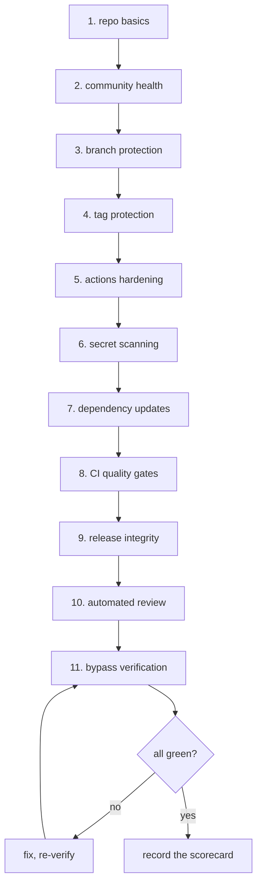

# Repository hardening checklist — reusable across projects

A complete, ordered checklist for taking a repository from "code on GitHub" to
"protected, gated and auditable". Every item states what to do, how to verify it,
and what it costs.

Derived from the MLX Studio hardening pass on 2026-11-24, where each control was
verified by attempting to bypass it. Reuse the order: earlier items make later
ones cheaper.

## 0. How to use this document

| Column | Meaning |
|---|---|
| **Item** | The control |
| **Verify** | The command or observation that proves it |
| **Cost** | Free tier, plan-limited, or paid |
| **Owner** | Who can do it (repo admin, maintainer, anyone) |

Work top to bottom. Stop at any line and the repository is still better than
before — the order is chosen so nothing later depends on something skipped.

---

## 1. Repository basics

| # | Item | Verify | Cost | Owner |
|---|---|---|---|---|
| 1.1 | Public or private decided deliberately | `GET /repos/{owner}/{repo}` → `visibility` | free | admin |
| 1.2 | Description set | repo page shows a one-line summary | free | admin |
| 1.3 | Topics set (5–10) | repo page shows topic chips | free | admin |
| 1.4 | Default branch named `main` | `GET /repos/...` → `default_branch` | free | admin |
| 1.5 | `LICENSE` present at root | GitHub detects the SPDX id | free | maintainer |
| 1.6 | `README.md` with install, usage, screenshots | renders on the repo landing page | free | maintainer |
| 1.7 | `CHANGELOG.md` with a versioned entry | one section per release | free | maintainer |
| 1.8 | `.gitignore` covers build output, caches, env, secrets, weights | `git status --ignored` shows only intended paths | free | maintainer |
| 1.9 | `.gitattributes` normalises line endings | `* text=auto` | free | maintainer |

Verification for 1.8 that catches real mistakes:

```bash
git status --porcelain --ignored | grep '^!!'     # what is ignored
git ls-files | while read f; do git check-ignore -q "$f" && echo "TRACKED BUT IGNORED: $f"; done
```

---

## 2. Community health files

GitHub scores these in `GET /repos/{owner}/{repo}/community/profile`. Target
**100%**; MLX Studio reached 100% after adding the four missing files.

| # | Item | Path | Verify | Cost |
|---|---|---|---|---|
| 2.1 | README | `README.md` | profile `files.readme` non-null | free |
| 2.2 | License | `LICENSE` | profile `files.license` non-null | free |
| 2.3 | Contributing guide | `CONTRIBUTING.md` | profile `files.contributing` non-null | free |
| 2.4 | Code of conduct | `CODE_OF_CONDUCT.md` | profile `files.code_of_conduct` non-null | free |
| 2.5 | Security policy | `SECURITY.md` at **root** | `/security/policy` returns 200 | free |
| 2.6 | Issue templates | `.github/ISSUE_TEMPLATE/*.md` + `config.yml` | New issue shows the chooser | free |
| 2.7 | PR template | `.github/pull_request_template.md` | New PR pre-fills the body | free |
| 2.8 | CODEOWNERS | `.github/CODEOWNERS` | Settings → Code owners shows parsed rules | free |

`SECURITY.md` must be at the repository root (or `.github/`). A copy under
`docs/` is not detected by GitHub's security tab.

---

## 3. Branch protection

Use a **ruleset**, not classic branch protection: one object holds the rules,
bypass actors and required checks, and it is visible at `/rules/`.

| # | Rule | Why | Verify |
|---|---|---|---|
| 3.1 | `deletion` | `main` cannot be deleted | `git push origin :main` → rejected |
| 3.2 | `non_fast_forward` | no force-push, no history rewrite | force-push → rejected |
| 3.3 | `required_linear_history` | no merge bubbles | merge commit → rejected |
| 3.4 | `pull_request` | every change through a PR | direct push → `GH013` |
| 3.5 | `required_status_checks` | CI is the gate | merge blocked while red |
| 3.6 | `strict_required_status_checks_policy: true` | a green run on a stale base does not count | PR shows "branch out of date" |
| 3.7 | `required_review_thread_resolution: true` | comments must be resolved | merge blocked with an open thread |
| 3.8 | `bypass_actors: []` | nobody skips, including the owner | `current_user_can_bypass: never` |
| 3.9 | `allowed_merge_methods` excludes rebase | keeps history linear | repo settings show rebase off |
| 3.10 | Approval count matches collaborator count | see §3.1 | `GET /pulls/{n}/reviews` is not `NONE` when count ≥ 1 |

### 3.1 The single-maintainer trap

`required_approving_review_count: 1` **deadlocks** a solo repository. GitHub
forbids approving your own pull request — verified:

```
POST /repos/{owner}/{repo}/pulls/{n}/reviews  {"event":"APPROVE"}
HTTP 422  "Review Can not approve your own pull request"
```

So a single-account repository cannot require an approval at all. Two valid
states, and the order of the switch matters:

| Collaborators | `required_approving_review_count` | `require_last_push_approval` |
|---|---|---|
| 1 | `0` | `false` |
| 2+ | `1` | `true` |

**Add the collaborator first, raise the count second.** Raising it first freezes
`main`, including urgent fixes. Automate the order:

```bash
./scripts/set_approval_gate.sh --check                  # report state
./scripts/set_approval_gate.sh --reviewer <username>    # add, then raise to 1
./scripts/set_approval_gate.sh --disable                # back to 0
```

Never claim "PRs are approved" when the count is 0. A merged PR with no review
record is a PR that was never approved; check `GET /pulls/{n}/reviews` and expect
`NONE` in single-maintainer mode.

### 3.2 Verify the ruleset

```bash
gh api repos/{owner}/{repo}/rulesets | jq '.[] | {id, name, target, enforcement}'
gh api repos/{owner}/{repo}/rulesets/{id} | jq '.rules[].type'
git push origin HEAD:main          # must be rejected
```

---

## 4. Tag protection

Tags are mutable and unprotected by default. A release tag that can be moved
invalidates every checksum published against it.

| # | Rule | Verify |
|---|---|---|
| 4.1 | Ruleset target `tag`, `refs/tags/v*` | ruleset list shows the tag ruleset |
| 4.2 | `deletion` | `git push origin :refs/tags/v1.0.0` → rejected |
| 4.3 | `non_fast_forward` | force-move a tag → rejected |
| 4.4 | `bypass_actors: []` | `current_user_can_bypass: never` |

Creation is still open by design: a new tag can be pushed. Gate that with a
release workflow if the project needs it.

---

## 5. Actions hardening

| # | Item | Setting | Verify |
|---|---|---|---|
| 5.1 | SHA pinning required | `sha_pinning_required: true` | `GET /actions/permissions` |
| 5.2 | Every `uses:` pinned to a commit SHA | `grep 'uses:' .github/workflows/*.yml` | no `@vN` remains |
| 5.3 | Default token read-only | `default_workflow_permissions: read` | `GET /actions/permissions/workflow` |
| 5.4 | Token cannot approve PRs | `can_approve_pull_request_reviews: false` | same endpoint |
| 5.5 | Per-workflow `permissions:` block | each workflow declares the minimum | review each file |
| 5.6 | No `pull_request_target` with checkout of the PR head | grep the workflows | absent |

Resolve a tag to a SHA:

```bash
gh api repos/actions/checkout/git/ref/tags/v4 --jq '.object.sha'
```

Pin with the tag kept as a comment so a human can still read it:

```yaml
- uses: actions/checkout@11d5960a326750d5838078e36cf38b85af677262  # v4
```

### 5.1 Permission minimisation

A workflow that only reads code needs `contents: read` and nothing else. Granting
`pull-requests: write` to a lint job that never comments is unnecessary
privilege — MLX Studio had exactly that and it was removed.

---

## 6. Secret scanning

| # | Feature | Verify | Cost |
|---|---|---|---|
| 6.1 | Secret scanning | `security_and_analysis.secret_scanning.status` | free for public |
| 6.2 | Push protection | `secret_scanning_push_protection.status` | free for public |
| 6.3 | Dependabot alerts | `GET /vulnerability-alerts` → 204 | free |
| 6.4 | Dependabot security updates | `dependabot_security_updates.status` | free |
| 6.5 | Private vulnerability reporting | `GET /private-vulnerability-reporting` | free |
| 6.6 | Non-provider patterns | `secret_scanning_non_provider_patterns.status` | plan-limited |
| 6.7 | Validity checks | `secret_scanning_validity_checks.status` | plan-limited |

6.6 and 6.7 are unavailable through the API on a free user plan; both `PATCH`
payloads and the dedicated endpoints return 404 or no-op. Enable them in the UI
if the plan supports it, and cover the gap with a local scanner.

### 6.1 Local scanner, three enforcement points

GitHub's push protection only knows provider patterns. A project-specific scanner
catches internal shapes, `.env` files and connection strings.

| Point | Scope | Bypass | Backstop |
|---|---|---|---|
| pre-commit | staged content | `--no-verify` | pre-push |
| pre-push | outgoing range + HEAD tree | `--no-verify` | CI |
| CI | tree + full history | none | — |

Rules to cover at minimum: GitHub tokens (4 forms), OpenAI, Anthropic, AWS key
pair, Google, Slack, Stripe, Hugging Face, private key blocks, JWTs, connection
strings with inline passwords, `password =`, `api_key =`.

Provide an inline suppression (`secret-scan: allow`) so a documentation
placeholder does not need a rule change.

---

## 7. Dependency updates

| # | Item | Path | Verify |
|---|---|---|---|
| 7.1 | Dependabot config | `.github/dependabot.yml` | Actions tab shows Dependabot |
| 7.2 | `github-actions` ecosystem | weekly, grouped | PR appears after the schedule |
| 7.3 | Runtime ecosystem (`pip`, `npm`, `cargo`, …) | weekly | same |
| 7.3a | A manifest exists for that ecosystem | `requirements.txt`, `package.json`, … | the ecosystem job fails without one |
| 7.4 | `open-pull-requests-limit` set | 5 is a sane default | config |
| 7.5 | Commit prefix per ecosystem | `ci:` / `deps:` | PR titles |
| 7.6 | Vulnerability scan in CI | `pip-audit`, `npm audit`, `cargo audit` | a CI job |

Dependabot rewrites a pinned SHA and keeps the trailing tag comment, so 5.2 and
7.2 work together.

**The pip ecosystem needs a manifest.** MLX Studio declared `package-ecosystem:
pip` with no `requirements.txt`, so the Dependabot pip job failed with
`Dependabot failure` while the `github-actions` job succeeded. Add a
`requirements.txt` (or `pyproject.toml`) before enabling that ecosystem — even a
pin-only file whose only purpose is to give tooling something to read.

---

## 8. CI quality gates

| # | Job | Fails when | Cost |
|---|---|---|---|
| 8.1 | Lint | any lint error | free |
| 8.2 | Format check | any unformatted file | free |
| 8.3 | Syntax gates | Python, JS or shell does not parse | free |
| 8.4 | Secret scan | any blocking finding | free |
| 8.5 | Security audit | any audit check fails | free |
| 8.6 | Documentation links | any relative link is broken | free |
| 8.7 | Hook installer | hooks missing or not executable | free |
| 8.8 | Automated review | report job posts a sticky comment | free |

### 8.1 Runner choice

Verify a runner actually starts before depending on it:

```yaml
jobs:
  probe:
    strategy:
      matrix:
        os: [ubuntu-latest, macos-14]
    runs-on: ${{ matrix.os }}
    steps:
      - run: echo "${{ matrix.os }} ok"
```

MLX Studio found `macos-14` never starts on its repository — jobs cancelled with
zero steps and no runner assigned, while `ubuntu-latest` completed. Prefer
`ubuntu-latest`; make scripts portable rather than paying for a macOS runner.

### 8.2 Portability traps

| Trap | Symptom | Fix |
|---|---|---|
| `stat -f` on Linux | exits 0 but prints filesystem stats, not a mode | branch on `uname -s`, never on exit status |
| `sed -i` without a suffix | GNU vs BSD differ | `sed -i.bak` then remove, or use Python |
| `readlink -f` | absent on older BSD | `python3 -c 'os.path.realpath'` |
| `grep -q` under `pipefail` | SIGPIPE makes the pipeline look failed | capture to a variable first |
| Locale-dependent sort | differs between runners | `LC_ALL=C sort` |

---

## 9. Release integrity

| # | Item | Verify |
|---|---|---|
| 9.1 | Version in one place | `APP_VERSION` grepped into the manifest and plist |
| 9.2 | Artifact checksum published | manifest carries `sha256` and `size` |
| 9.3 | Artifact signature verified | `codesign --verify --deep --strict` |
| 9.4 | **Bundle matches source** | `cmp` bundled file against the working tree |
| 9.5 | Manifest schema validated | version, https url, 64-hex sha, positive size |
| 9.6 | Downloaded asset re-verified | `shasum -a 256` equals the manifest |

### 9.1 The stale-artifact trap

A bundle built **before** a security fix ships the vulnerable code while the
source looks clean. MLX Studio hit exactly this: the released DMG contained the
removed `/api/quit` endpoint and lacked the traversal fix.

Add a freshness check to the audit:

```bash
cmp -s "dist/App.app/Contents/Resources/app.py" app.py \
  || echo "FAIL: bundled app differs from source"
```

Run it before every tag, and rebuild whenever it fails.

---

## 10. Automated PR review

| # | Item | Detail |
|---|---|---|
| 10.1 | Runs on `opened`, `synchronize`, `reopened`, `ready_for_review` | not only on open |
| 10.2 | Posts one sticky comment | identify it with an HTML marker and update in place |
| 10.3 | Reports, never approves | no review API call |
| 10.4 | Lists changed files | a table with `+/-` per file |
| 10.5 | Skips drafts | `if: github.event.pull_request.draft == false` |
| 10.6 | Concurrency group per PR | cancels superseded runs |

A report job that also blocked would duplicate the required checks; keep the two
roles separate.

---

## 11. Verification: prove each control

Do not record a control as done because it was configured. Attempt the bypass.

| # | Attempt | Expected |
|---|---|---|
| 11.1 | `git push origin HEAD:main` | rejected, `GH013` |
| 11.2 | `git push --force origin main` | rejected |
| 11.3 | `git push origin :refs/tags/v1.0.0` | rejected |
| 11.4 | Commit a fake `ghp_…` token | pre-commit blocks |
| 11.5 | Commit with `--no-verify`, then push | pre-push blocks |
| 11.6 | Push both bypasses to a branch, open a PR | CI blocks |
| 11.7 | Open a PR with a red check | merge blocked |
| 11.8 | Add an unpinned `uses: action@v1` | CI fails on SHA pinning |
| 11.9 | Rebuild the bundle, run the audit | SA-15 passes |
| 11.10 | Compare a downloaded asset to the manifest | checksums match |

Record the observed output, not the intent. `GH013: Repository rule violations`
is evidence; "branch protection is on" is not.

---

## 12. Cost

| Item | Free tier |
|---|---|
| Actions on `ubuntu-latest`, public repo | unlimited |
| Rulesets, branch and tag protection | free |
| Secret scanning, push protection | free for public |
| Dependabot alerts and updates | free |
| Private vulnerability reporting | free |
| Automated review via a comment | free |
| CodeQL | free for public, needs a workflow |
| Copilot code review | paid — not used |
| macOS / Windows runners | metered — avoid |

Everything in this checklist is achievable at zero cost on a public repository.

---

## 13. Scorecard

Copy this into a new project and tick as you go.

| Area | Items | MLX Studio |
|---|---|---|
| 1. Repository basics | 9 | 9/9 |
| 2. Community health | 8 | 8/8 (100%) |
| 3. Branch protection | 10 | 9/10 (approval gate pending a 2nd account) |
| 4. Tag protection | 4 | 4/4 |
| 5. Actions hardening | 6 | 6/6 |
| 6. Secret scanning | 7 | 5/7 (2 plan-limited) |
| 7. Dependency updates | 7 | 7/7 |
| 8. CI quality gates | 8 | 8/8 |
| 9. Release integrity | 6 | 5/6 (stale DMG pending rebuild) |
| 10. Automated review | 6 | 6/6 |
| 11. Bypass verification | 10 | 10/10 |
| **Total** | **81** | **77/81** |

The four open items are one plan limitation (6.6, 6.7), one stale artifact (9.4)
and one pending approval gate (3.10), all named in the documents rather than
hidden.

These scores are the 2026-11-24 snapshot of 2.0.0 and have not been re-scored.
The stale DMG noted for 9.4 does not apply to `v2.0.9`, whose release audit
passed with 0 failures (2026-11-26, [DEPLOYMENT.md](DEPLOYMENT.md) section 5.3).

---

## 14. Order of work



Protection before automation: a ruleset with no checks is weak, and checks with
no ruleset can be bypassed. Do 3 and 4 first, then 8 and 10 give them teeth.

---

## 15. Sources read for this file

| Source | Used for |
|---|---|
| MLX Studio rulesets `28005254`, `28006578` | §3, §4 |
| `GET /actions/permissions`, `/permissions/workflow` | §5 |
| `GET /community/profile` | §2 |
| `security_and_analysis` on the repository | §6 |
| `.github/workflows/*.yml`, `.github/dependabot.yml` | §7, §8, §10 |
| `scripts/security_audit.sh` SA-01…SA-16 | §9, §11 |
| Bypass attempts, 2026-11-24 | §11 results |
