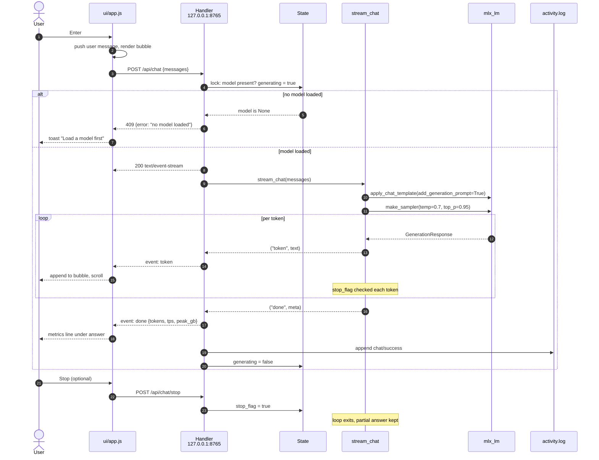

# Chat request path

One turn, from keystroke to metrics line.

## Timing observed on M6 / 32 GB, 7B 4-bit

| Segment | Observed |
|---|---|
| Request to first token | 0.4–0.9 s |
| Steady-state throughput | 42–53 tok/s |
| Peak memory | 4.37 GB |
| 3-token answer, total | 0.42 s |

## Rules the diagram encodes

| Rule | Where |
|---|---|
| Chat refuses without a loaded model | `409`, `app.py:608` |
| Tokens are flushed per emission | `emit` writes and flushes, `app.py:724` |
| Stop is a flag, not a kill | `State.stop_flag`, checked per token |
| The partial answer survives a stop | `_finish_generation` keeps accumulated text |
| Every completed turn is logged | `log_activity("chat", …)` in `_stream_chat` |
| The client disconnecting is not an error | `BrokenPipeError` caught, logged as failed |

## Failure paths

| Failure | Response | UI |
|---|---|---|
| No model | `409` | Toast, no bubble |
| Generation raises | SSE `event: error` | Red bubble with the message |
| Client disconnects | connection closed | Log entry `client disconnected` |
| Stop pressed | partial `done` | Partial answer plus metrics |
