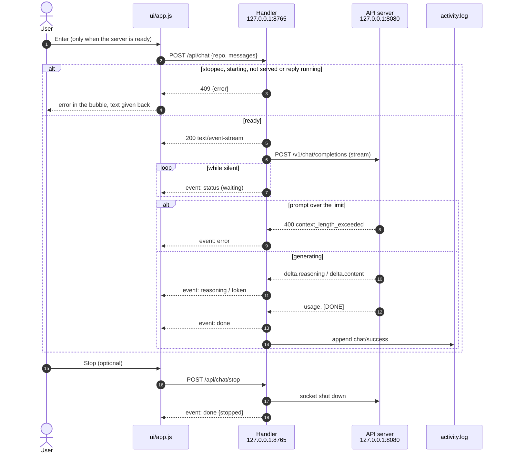

# Chat request path

One turn in the 2.0.13 source (unreleased). Released builds infer in the app.

## Failure paths

| Failure | Response | UI |
|---|---|---|
| Server not ready or model not served | `409` | Red bubble; typed text is returned |
| Server refuses (for example a long prompt) | SSE `error` | Red bubble with the server's words |
| Server stops mid-reply | SSE `error` | Partial reply kept with the reason; turn dropped from history |
| Reply ends or is stopped with thinking only | SSE `done` | Thinking shown as the reply; turn dropped from history |
| Browser goes away | upstream closed | Log entry `client disconnected` |
