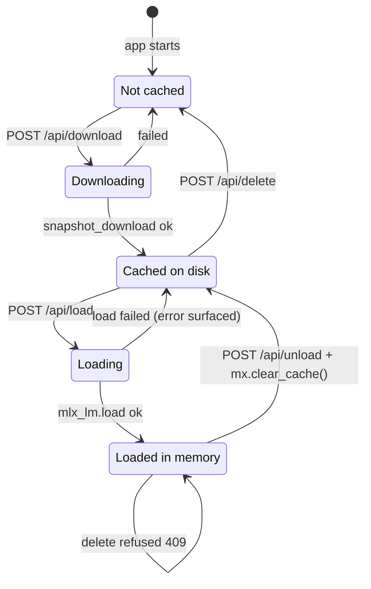
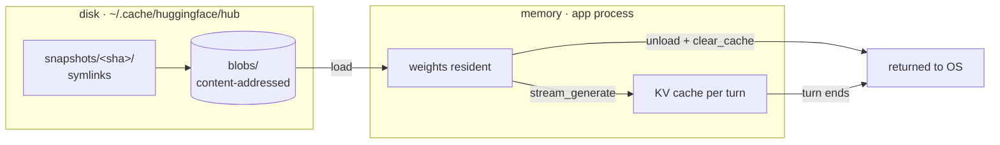

# Model lifecycle

Every state a model can be in, and the transition that moves it.

## Transition table

| From | Trigger | To | Guard | Logged |
|---|---|---|---|---|
| Not cached | `POST /api/download` | Downloading | not already running | `download/running` |
| Downloading | library returns | Cached | — | `download/success` |
| Downloading | library raises | Not cached | — | `download/failed` |
| Cached | `POST /api/load` | Loading | no other load in flight | `model/running` |
| Loading | `mlx_lm.load` returns | Loaded | — | `model/success` |
| Loading | `mlx_lm.load` raises | Cached | error stored | `model/failed` |
| Loaded | `POST /api/unload` | Cached | — | `model/info` |
| Loaded | `POST /api/delete` | — | refused `409` | — |
| Cached | `POST /api/delete` | Not cached | — | `delete/success` |

## What each state looks like in the UI

| State | Sidebar pill | Chat header | Models card | Load button |
|---|---|---|---|---|
| Not cached | — | — | absent | — |
| Downloading | — | — | — | — |
| Cached | `● No model loaded` | `● Not loaded` | no tag | **Load** |
| Loading | `● Loading <name>…` blue pulse | `● Loading <name>…` | — | disabled |
| Loaded | `● <name>` green | `● Loaded — <name>` | `loaded` tag | **Unload** |
| Load failed | `● No model loaded` | `● Load failed` red | — | **Load** |

## Disk and memory effects

| Action | Disk | Memory |
|---|---|---|
| Download | + size of weights | unchanged |
| Load | unchanged | + weights |
| Chat turn | unchanged | + KV cache for the prompt |
| Unload | unchanged | weights and cache released |
| Delete | − weights (shared blobs kept if another model uses them) | unchanged |

## Size accounting

`installed_models()` follows snapshot symlinks and de-duplicates by
`(st_dev, st_ino)`. Consequences:

- A blob shared by two models is counted once per model in the model's own total,
  but the on-disk total is smaller than the sum of the cards.
- A `4.0 GB` model reports `4.0 GB`, not `8.0 GB`. This was a defect fixed in
  2.0.0; see [CHANGELOG.md](../../CHANGELOG.md).
