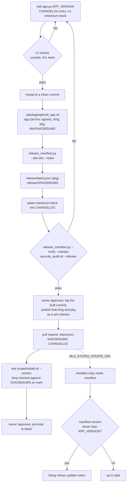

# Release flow

> **2.0.13 (unreleased) supersedes parts of this file.** `mlx_guard.py` and the 80%
> memory rule are removed: MLX is `mlx_lm`'s own server with one model, no memory or
> prompt limit and no request checks beyond `--allowed-origins`. Text, figures and
> diagrams about the guard, memory limits or two models apply to 2.0.12 and earlier.
> [What is no longer protected](../../README.md#protections-removed-in-2013).

How a change becomes an installed app, and how installed copies learn about the
next one.

## Artefacts produced

| Artefact | Path | Contains |
|---|---|---|
| App bundle | `dist/MLX Studio.app` | plist, icon, launcher binary, `app.py`, `mlx_guard.py`, `ui/` |
| Disk image | `dist/MLX.Studio-x.y.z.dmg` | app, `Applications` symlink, read-me |
| Package | `dist/*.pkg` | installs the app into `/Applications` |
| Manifest | `release/latest.json` | version, url, notes, published, sha256, size of the pkg |
| Checksums | `release/SHA256SUMS` | assets listed by the release tool. Starts at 2.0.9; no backfill |

Steps, order and current release state: [DEPLOYMENT.md](../DEPLOYMENT.md) sections 5 and 6.

## Gates before a tag

| Gate | Command | Blocks release |
|---|---|---|
| Python syntax | `python3 -m py_compile app.py mlx_guard.py` | yes |
| JS syntax | `node --check ui/app.js` | yes |
| Tests | `python3 -m pytest` | yes |
| Release files | `python3 packaging/release_manifest.py --verify --release --dist dist` | yes |
| Audit | `./scripts/security_audit.sh --release` | yes |
| Manual checks | [TESTING.md](../TESTING.md) section 6 | yes |

## Recorded for 2.0.0 (historical, DMG-only flow)

| Step | Result |
|---|---|
| DMG built | 979129 bytes |
| Signature | valid (ad-hoc) |
| `hdiutil verify` | CRC32 valid |
| Launch from DMG copy | `/api/ping` → `{"ok": true, "app": "2.0.0"}` |
| Asset download | HTTP 200, size matched |
| SHA-256 | `e4236659…` matched the manifest |
| Live manifest fetch | `latest 2.0.0`, `update false` |
