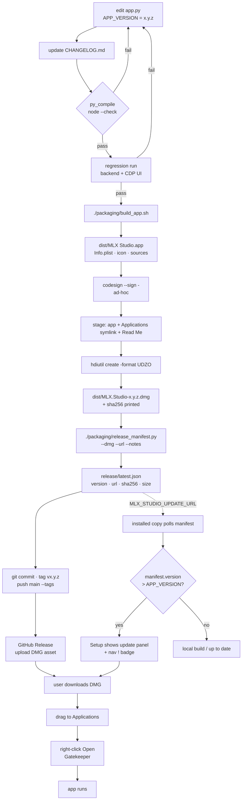

# Release flow

How a change becomes an installed app, and how installed copies learn about the
next one.

## Artefacts produced

| Artefact | Path | Contains |
|---|---|---|
| App bundle | `dist/MLX Studio.app` | plist, icon, `app.py`, `launcher.py`, `ui/` |
| Installer | `dist/MLX.Studio-x.y.z.dmg` | app, `Applications` symlink, `Read Me.txt` |
| Manifest | `release/latest.json` | version, url, notes, published, sha256, size |
| Release asset | GitHub Releases | the DMG |

## Gates before a tag

| Gate | Command | Blocks release |
|---|---|---|
| Python syntax | `python3 -m py_compile app.py` | yes |
| JS syntax | `node --check ui/app.js` | yes |
| Backend smoke | `/api/ping`, `/api/state`, SSE chat | yes |
| UI regression | CDP run, `RESULT: PASS` | yes |
| Signature | `codesign --verify --deep --strict` | yes |
| DMG integrity | `hdiutil verify` | yes |
| Install and launch | copy out, `open`, `/api/ping` | yes |
| Checksum match | download vs manifest `sha256` | yes |

## Verified for 2.0.0

| Step | Result |
|---|---|
| DMG built | 979129 bytes |
| Signature | valid (ad-hoc) |
| `hdiutil verify` | CRC32 valid |
| Launch from DMG copy | `/api/ping` → `{"ok": true, "app": "2.0.0"}` |
| Asset download | HTTP 200, size matched |
| SHA-256 | `e4236659…` matched the manifest |
| Live manifest fetch | `latest 2.0.0`, `update false` |
