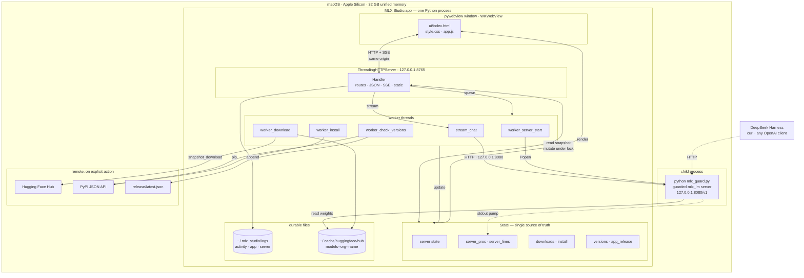

# Runtime view

> **2.0.13 (unreleased) supersedes parts of this file.** `mlx_guard.py` and the 80%
> memory rule are removed: MLX is `mlx_lm`'s own server with one model, no memory or
> prompt limit and no request checks beyond `--allowed-origins`. Text, figures and
> diagrams about the guard, memory limits or two models apply to 2.0.12 and earlier.
> [What is no longer protected](../../README.md#protections-removed-in-2013).

What runs when the app is open, and what talks to what.

## Reading the picture

| Element | Meaning |
|---|---|
| Solid arrow | Synchronous call in the same process |
| Dashed arrow | Asynchronous, optional, or cross-process |
| Cylinder | Durable storage on disk |
| `127.0.0.1` on both listeners | Nothing is reachable from the LAN |

## Facts the picture encodes

| Fact | Value | Source |
|---|---|---|
| UI/API port | `127.0.0.1:8765` | `app.py`, `PORT` |
| OpenAI server port | `127.0.0.1:8080` | `app.py`, `SERVER_PORT` |
| Server is a child process | started through `mlx_guard.py` | `app.py`, `GUARD_SCRIPT` |
| Inference is in the API server child (2.0.13) | `stream_chat` proxy | `app.py` |
| The app process loads no model | no `load` call | `app.py` |
| Server child models | one in 2.0.9; up to two in the unreleased source, taking turns | `mlx_guard.py`, `install_multi` |
| Logs are files | `~/.mlx_studio/logs/` | `app.py`, `LOG_DIR` |
| Weights are a file tree | Hugging Face cache | `app.py`, `CACHE_DIR` |
| Remote calls | search, download, install, version check | `search_hf`, `worker_download`, `worker_install`, `worker_check_versions` |

## What is deliberately absent

- No database process.
- No message broker.
- No authentication service.
- No telemetry endpoint.
- No listener on `0.0.0.0`.
