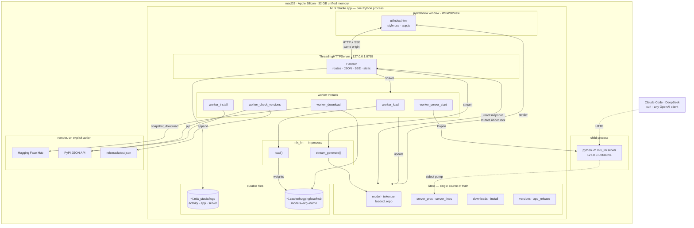

# Runtime view

What runs when the app is open, and what talks to what.

## Reading the picture

| Element | Meaning |
|---|---|
| Solid arrow | Synchronous call in the same process |
| Dashed arrow | Asynchronous, optional, or cross-process |
| Cylinder | Durable storage on disk |
| `127.0.0.1` on both listeners | Nothing is reachable from the LAN |

## Facts the picture encodes

| Fact | Value | Source |
|---|---|---|
| UI/API port | `127.0.0.1:8765` | `app.py:43` |
| OpenAI server port | `127.0.0.1:8080` | `app.py:44` |
| Server is a child process | `Popen([... "mlx_lm", "server" ...])` | `app.py:466` |
| Inference is in-process | `stream_generate(model, ...)` | `app.py:315` |
| One model slot | `State.model` | `app.py:223` |
| Logs are files | `~/.mlx_studio/logs/` | `app.py:39` |
| Weights are a file tree | `~/.cache/huggingface/hub` | `app.py:37` |
| Remote calls are explicit | download, install, version check | `app.py:378`, `383`, `410` |

## What is deliberately absent

- No database process.
- No message broker.
- No authentication service.
- No telemetry endpoint.
- No listener on `0.0.0.0`.
