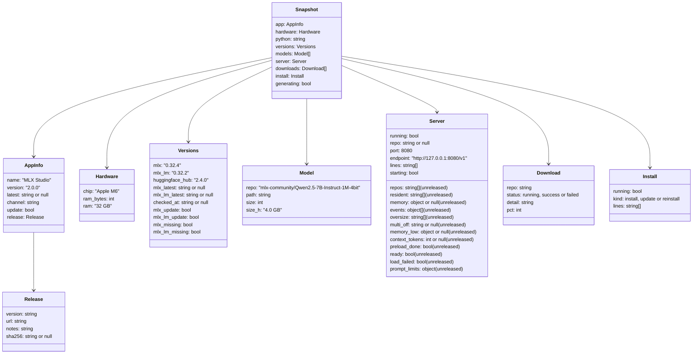

# State model

`GET /api/state` returns one object. Every surface in the UI renders from it, so
this shape is the contract between backend and interface.

## Field semantics

| Field | Meaning | Consumed by |
|---|---|---|
| `app.version` | Running build | Sidebar, Setup |
| `app.latest` | Newest manifest version, or null | Setup pill, update panel |
| `app.update` | `latest > version` | Nav badge, update panel |
| `versions.mlx_update` | PyPI newer than installed | Setup pill, nav badge |
| `versions.mlx_missing` | Not importable | Setup pill, install button label |
| `models[]` | Cached repos with true size | Models cards, API Server selects |
| `server.running` | Child process alive | Server pill, nav dot |
| `server.lines` | Last 400 stdout lines | Server console |
| `server.starting` | A start is under way | Chat state line |
| `server.ready` (unreleased) | The server reported that it can answer | Chat model select, input and Send |
| `server.load_failed` (unreleased) | The server reported that it could not load its model | Chat **Model not loaded** |
| `server.prompt_limits` (unreleased) | Longest prompt accepted per served model, in tokens | **Prompt limit** line on API Server |
| `server.repos`, `server.resident` (unreleased) | Models started with; models in memory, current first | Server pill |
| `server.memory` (unreleased) | Measured bytes at the last load or switch; with two models also refreshed about every 10 s | Memory line on API Server |
| `server.events` (unreleased) | Recent load, trim and eviction events; refresh events not recorded | Notice on API Server, server console |
| `server.oversize` (unreleased) | Models loaded alone although they do not fit | **Loaded without enough memory** notice |
| `server.multi_off` (unreleased) | Why only one model is kept | Notice on API Server |
| `server.memory_low` (unreleased) | `null` or `{free_bytes, short_by_bytes}` when free memory is short of what the server may still take; `null` until preload ends | **Free memory is low** notice |
| `server.context_tokens` (unreleased) | Context per model of a two-model server, else `null` | Prompt length line, **Loaded without enough memory** text |
| `server.preload_done` (unreleased) | Preload has ended, however it ended | Gate for `server.memory_low` |
| `downloads[]` | Per-repo download status | Download cards |
| `install.lines` | pip output | Setup console |
| `generating` | A chat stream is in flight | Send/Stop visibility |

## Invariants

| Invariant | Enforced by |
|---|---|
| `server.ready` and `server.load_failed` are never both true | `_server_readiness` takes both from one report |
| `server.running` is true only while `server_proc` is not None | `worker_server_start`, `stop_server` |
| `app.update` is false when `app.latest` is null | `is_newer` returns false for a null candidate |
| `versions.mlx_update` is false when the latest is unknown | same |
| `models[].size` counts each inode once | `installed_models` de-duplication |

## Polling contract

| Property | Value |
|---|---|
| Interval | 2000 ms |
| Method | `GET /api/state` |
| Payload | a few KB |
| Rendering | idempotent full re-render |
| Missed poll | self-heals on the next one |
| Cache | `Cache-Control: no-store` |
