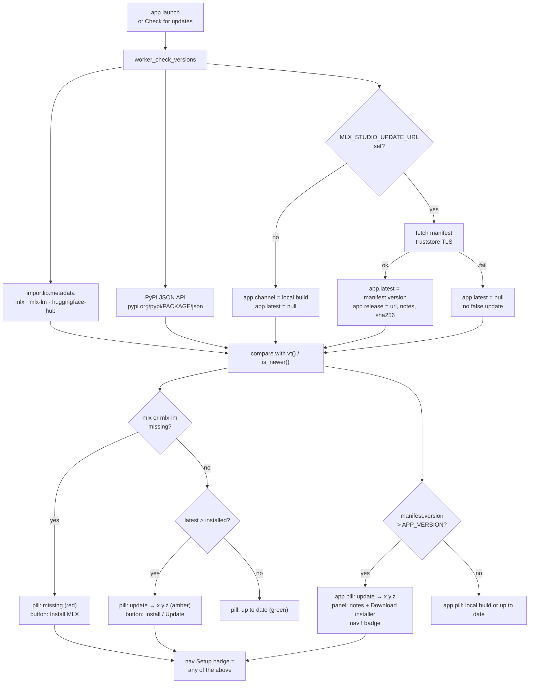

# Update decision

Two independent channels feed one badge. This diagram shows exactly what the app
compares and what it renders.

## Comparison rules

| Rule | Implementation | Example |
|---|---|---|
| Numeric, not lexical | `vt()` splits on `.`, `-`, `+`; digit runs become ints | `0.32.10 > 0.32.9` |
| Missing installed version | Treated as older than any candidate | `None` → update |
| Missing candidate | No update claimed | PyPI unreachable → no pill change |
| Equal versions | No update | `0.32.4` vs `0.32.4` → up to date |
| No channel | Never claims an app update | `local build` |

## Rendered outcomes

| Condition | App pill | Package pill | Nav badge | Panel |
|---|---|---|---|---|
| All current, no channel | `local build` | `up to date` | hidden | hidden |
| All current, channel set | `up to date` | `up to date` | hidden | hidden |
| Package behind | `up to date` | `update → x.y.z` | shown | hidden |
| App behind | `update → x.y.z` | `up to date` | shown | shown |
| Package missing | `local build` | `missing` | shown | hidden |
| Both behind | `update → x.y.z` | `update → x.y.z` | shown | shown |

## Observed on this machine

| Field | Value |
|---|---|
| MLX installed / latest | `0.32.4` / `0.32.4` |
| MLX-LM installed / latest | `0.32.2` / `0.32.2` |
| huggingface-hub | `2.4.0` |
| App version | `2.0.0` |
| Channel without env var | `local build` |
| Channel with 2.1.0 manifest | `update → 2.1.0`, panel visible |
| Last check | `2026-11-24 22:10:17` |

## Failure behaviour

| Failure | Effect |
|---|---|
| PyPI unreachable | Pills show no comparison; no error dialog; app keeps working |
| Manifest unreachable | `app.latest` stays null; no update claimed |
| TLS chain missing | `truststore` injected first; without it the fetch fails and is treated as unreachable |
| Malformed manifest JSON | Treated as unreachable |
